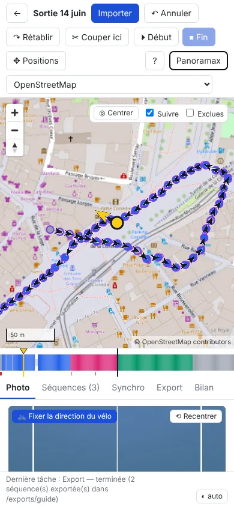

# Guide d'utilisation — Panoramax Sequence Studio

Panoramax Sequence Studio prépare les photos 360° d'une sortie à vélo prise avec une GoPro MAX (une photo toutes
les ~2 s, souvent des milliers) avant leur publication sur [Panoramax](https://panoramax.fr) :

- découper la sortie en **séquences** et écarter les photos inutiles (arrêts, doublons, photos ratées) ;
- corriger le **retard du GPS** de la GoPro et les **positions** fausses ;
- vérifier les **caps** (direction du vélo) et l'**orientation** de la caméra (casque, caméra à l'envers) ;
- **exporter** un dossier par séquence, avec des EXIF corrigés et lus correctement par Panoramax.

La publication sur Panoramax ne se fait pas depuis l'application : on envoie ensuite les dossiers exportés (voir
[§ 9](#9-publier-sur-panoramax)).

Les captures d'écran de ce guide ont été faites avec une sortie simulée près de Montpellier : les photos sont des
images de test (bandes de couleur), pas de vraies vues.

Sommaire : [1. Installer et lancer](#1-installer-et-lancer) · [2. Projets](#2-projets) ·
[3. L'écran](#3-lécran) · [4. Découper en séquences](#4-découper-en-séquences) ·
[5. Corriger le retard GPS](#5-corriger-le-retard-gps-onglet-synchro) ·
[6. Corriger des positions](#6-corriger-des-positions) · [7. Caps et orientation](#7-caps-et-orientation) ·
[8. Exporter](#8-exporter) · [9. Publier sur Panoramax](#9-publier-sur-panoramax) ·
[10. Raccourcis clavier](#10-raccourcis-clavier) · [11. Questions fréquentes](#11-questions-fréquentes)

---

## 1. Installer et lancer

### Avec Docker (recommandé)

```sh
git clone https://github.com/qhess34/panoramax-preprocess.git && cd panoramax-preprocess
cp .env.example .env          # indiquer PHOTOS_DIR (vos sorties GoPro) et PUID/PGID (commandes : id -u ; id -g)
mkdir -p data photos exports  # (ou les dossiers indiqués dans .env) : à créer AVANT le premier lancement
docker compose up -d --build
```

Ouvrir ensuite <http://127.0.0.1:8765>. L'application n'est accessible que depuis cette machine (elle donne accès
aux dossiers montés).

| Dans l'application | Sur votre machine (`.env`) | Rôle |
|---|---|---|
| `/photos` | `PHOTOS_DIR` | photos à importer ; destination des modes d'export *Déplacer* / *Sur place* |
| `/exports` | `EXPORTS_DIR` | exports en mode *Copier* |
| `/data` | `DATA_DIR` | projets (bases, miniatures) |

**Mise à jour** : `git pull && docker compose up -d --build` — sans `--build`, l'ancienne version continue de
tourner. Arrêt : `docker compose down` (les projets restent dans `DATA_DIR`).

### Sans Docker (Linux)

Prérequis : Python ≥ 3.11, Node.js ≥ 20, ExifTool (`sudo apt install libimage-exiftool-perl`).

```sh
./run.sh          # la 1re fois : installe et construit l'interface ; puis http://127.0.0.1:8765
```

Un projet créé avec Docker s'utilise avec Docker, et un projet créé avec `run.sh` avec `run.sh` (les chemins des
photos enregistrés ne sont pas les mêmes).

---

## 2. Projets

Un **projet** = une sortie (ou plusieurs). Page d'accueil : saisir un nom puis *Créer le projet* ; ouvrir un projet en cliquant son nom ; *Supprimer*
(avec confirmation).
Le nom du projet sert à nommer les dossiers exportés (`<nom>_1`, `<nom>_2`…).


*Page d'accueil : création et liste des projets.*

**Les photos ne sont pas copiées** : le projet garde le chemin de chaque photo, les métadonnées lues et vos
corrections. Supprimer un projet ne touche pas aux photos.

**Importer** (bouton de la barre d'outils) : choisir un ou plusieurs dossiers ; les sous-dossiers sont parcourus
(`100GOPRO`, `101GOPRO`…). Une photo déjà importée n'est pas importée deux fois. L'import lit les EXIF puis crée les
miniatures en tâche de fond : la carte est utilisable avant la fin.

Onglet **Bilan** : nombre de photos, période, anomalies détectées :

| Anomalie | Signification |
|---|---|
| sans GPS | pas de position (début de sortie, tunnel) |
| saut GPS | position aberrante par rapport aux voisines (vitesse impossible) |
| doublon | même photo importée deux fois (même contenu) |
| interruption | trou de plus de 10 s dans la prise de vue (pause, changement de batterie) |
| illisible / introuvable | fichier abîmé, ou déplacé depuis l'import (*Vérifier les fichiers*) |


*Onglet *Bilan* : anomalies de la sortie (surlignées), réglage de la surcouche Panoramax, vérification des fichiers.*

Les photos sans GPS, sans date, en doublon, illisibles ou introuvables ne peuvent pas entrer dans une séquence.
L'onglet *Bilan* contient aussi le réglage de la surcouche Panoramax ([§ 3](#surcouche-panoramax)),
*Vérifier les fichiers* et, s'il y en a, *Relancer les miniatures en échec*.

---

## 3. L'écran

```
┌ barre d'outils : ← projets · Importer · Annuler/Rétablir · Couper ici · Début · Fin · Positions · ? · Panoramax · fond de carte
├──────────────────────────────────────────────┬──────────────────────────────┐
│ carte                                        │ onglets :                    │
│   (Centrer · Suivre · Exclues · Reporter…)   │ Photo · Séquences · Synchro  │
│                                              │ Export · Bilan               │
├──────────────────────────────────────────────┤                              │
│ timeline (toute la sortie)                   │                              │
└──────────────────────────────────────────────┴──────────────────────────────┘
```


*Écran principal : carte (pastilles colorées par séquence, flèches de cap, photo courante en jaune), timeline en bas (une couleur par séquence, gris = non classées), visionneuse 360° et cap à droite.*

- **Carte** : une pastille par photo, colorée selon sa séquence (gris = non classée). À partir du zoom 15, une
  flèche montre le cap de chaque photo ; la photo courante est en jaune, et sa flèche tourne avec la direction
  regardée dans la visionneuse. Clic sur une pastille : aller à la photo ; Maj+clic : sélectionner une plage.
  - *Suivre* (coché par défaut) : la carte suit la photo courante ; décoché, elle reste fixe, *◎ Centrer* recentre.
  - *Exclues* : afficher les photos exclues (masquées par défaut).
- **Fond de carte** (liste en haut à droite) : OpenStreetMap, Esri (satellite), **Satellite IGN Ortho** (France,
  ~20 cm, souvent le plus net), *IGN Ortho zoom max* (jusqu'au zoom 21 là où l'IGN a de la très haute résolution,
  vide ailleurs aux plus forts zooms), OpenTopoMap, ou un fond XYZ ajouté par vous (*+ Ajouter un fond XYZ…*).
- **Timeline** : toute la sortie, une case par photo, colorée par séquence ; trous = photos exclues, marques rouges
  = anomalies. Clic : aller à la photo ; **glisser** (au moins quelques pixels) ou Maj+clic : sélectionner une
  plage (en jaune). `Échap` efface la plage.
- **Onglet Photo** : visionneuse 360° (glisser pour regarder, molette pour zoomer, *À plat* pour l'image brute,
  *⟲ Recentrer* pour revenir face à l'avant), boutons *⏵ Début* / *⏹ Fin*, cap, position, et outils de la plage
  sélectionnée.

### Surcouche Panoramax

Bouton **Panoramax** : affiche les photos 360° **déjà publiées**, pour voir ce qui manque ou ce qui est ancien.
Couleur selon l'âge : vert moins d'un an, orange 1 à 3 ans, rouge plus de 3 ans. Séquences visibles à partir du
zoom 7, photos à partir du zoom 15. Au survol : date, appareil, **auteur**.

Source (onglet *Bilan*) : **toutes les instances** (par défaut, méta-catalogue de panoramax.fr), OpenStreetMap
France, IGN, ou l'adresse d'une autre instance.


*Surcouche Panoramax (données réelles) : rouge = photos de plus de 3 ans, orange = 1 à 3 ans ; au survol, date, appareil et auteur.*

### Sur téléphone

L'écran s'empile : barre d'outils, carte, timeline, puis les onglets.


*Affichage à 390 px de large.*

---

## 4. Découper en séquences

Une séquence = un passage continu que l'on publiera d'un bloc. On parcourt la sortie photo par photo
(`←` `→`, Maj : par 10) dans la visionneuse ; plusieurs méthodes, combinables :

**Début / Fin (le plus simple)**
1. Sur la première photo de la séquence : `D` (*⏵ Début*).
2. Avancer avec `→` : la plage suit en jaune.
3. Sur la dernière photo : `F` (*⏹ Fin*) → la séquence est créée.
4. La photo suivante devient **aussitôt le début de la séquence suivante** : on continue d'avancer et on refait `F`
   à la fin de chaque séquence. `Échap` annule le début en cours.


**Début* posé sur la photo 341 : la plage suit la navigation (en jaune sur la timeline), le bouton *Fin* indique le nombre de photos de la future séquence.*

**Couper** : `C` (*✂ Couper ici*) sur la première photo de chaque nouvelle séquence. Sur une photo non classée, la
séquence est d'abord créée autour d'elle, puis coupée : il suffit d'appuyer sur `C` à chaque coupure.

**Automatique** (onglet *Séquences*) :
- *Tout en séquences* : une séquence par bloc de photos non classées, à redécouper ensuite avec `C` ;
- *Découpage proposé* : coupe aux interruptions (> N s) et aux sauts de position (> N m), en ignorant les blocs
  trop courts ; cocher / décocher puis *Créer*.

**Depuis une plage** de la timeline : *Créer une séquence avec la plage* (ou `F`).

**Exclure des photos** (arrêts, feux rouges, photos ratées) : `X` ou `Suppr` exclut la photo courante et passe à la
suivante ; appuyer plusieurs fois exclut une série. Si la photo exclue était le *Début* en cours, le début passe à
la suivante. Avec une plage sélectionnée (et pas de début en cours), `X` exclut **toute la plage, après
confirmation** (le nombre de photos est indiqué). Les photos exclues :
- sont masquées sur la carte et sautées par `←` `→` (case *Exclues* pour les revoir) ;
- n'entrent dans aucune séquence et ne sont jamais exportées ;
- ne sont pas supprimées du disque. Pour en réintégrer une : cocher *Exclues*, aller dessus (ou cliquer son trou
  dans la timeline), `Maj+X`. Pour annuler une exclusion récente : `Ctrl+Z`.

**Modifier une séquence** (onglet *Séquences*) : clic sur le nom = aller au début ; double-clic ou *Renommer* ;
*Limites = plage* (la séquence devient la plage sélectionnée) ; *Fusionner avec la suivante* ; *Couper ici* ;
*Supprimer* (les photos redeviennent non classées). Les séquences au nom par défaut sont renumérotées dans l'ordre
de la sortie.


*Onglet *Séquences* : création, correction du montage de la caméra, découpage proposé, et pour chaque séquence son état d'export (*exportée*, *à réexporter*), sa durée, sa longueur, ses caps et ses actions.*

`Page ↑` / `Page ↓` passent d'une séquence à l'autre. **Tout est annulable** : `Ctrl+Z` / `Ctrl+Y`.

---

## 5. Corriger le retard GPS (onglet Synchro)

La GoPro enregistre la position avec 0,5 à 3 s de retard : chaque photo est placée un peu derrière l'endroit où elle
a été prise. On mesure ce retard une fois et on l'applique à toute la sortie.

1. Choisir un fond satellite (en France : *Satellite IGN Ortho*).
2. Trouver une photo où l'on voit un repère net, visible aussi sur la vue satellite (passage piéton, angle de
   bâtiment, ligne d'arrêt). Agrandir la photo (molette).
3. Faire glisser le **marqueur orange** sur la carte jusqu'à l'endroit réel de la photo : il ne peut aller que
   **le long de la trace**, et le décalage en secondes s'affiche ; toutes les photos se décalent en aperçu (points
   orange).
4. Vérifier sur d'autres photos (`←` `→`). Enregistrer des **points de calage** sur plusieurs repères : la médiane
   est proposée.
5. *Appliquer* à toute la sortie (proposé par défaut pour la première synchronisation), à la séquence, à une plage,
   ou **à partir de la photo courante** jusqu'à la fin de la sortie.

**Retard qui change pendant la sortie** (par exemple 2 s sur les 100 premières photos, puis 1 s) : synchroniser
d'abord toute la sortie, puis aller là où le retard change et synchroniser à nouveau. Après une première
synchronisation, la portée proposée devient *À partir de cette photo* : les photos d'avant gardent leur décalage et
ne sont pas marquées *à réexporter*. La médiane proposée ne tient compte que des points de calage de la portée
choisie.


*Onglet *Synchro* sur le fond *Satellite IGN Ortho* : marqueur orange de la photo courante, positions décalées en aperçu (points orange) le long de la trace ; décalage en secondes à droite.*

Chaque photo est alors placée sur la trace à l'instant de prise de vue + décalage ; les photos en saut GPS ou sans
GPS reçoivent aussi une position. Les positions corrigées à la main sont gardées (option). Annulable.

Conseil : caler sur une portion où la trace suit bien la route. Si le GPS est décalé sur le côté (rue parallèle),
la projection sur la trace donne un décalage faux.

---

## 6. Corriger des positions

`M` (ou *✥ Positions*) active le mode Positions :
- **glisser le marqueur violet** de la photo courante à sa vraie place ;
- photo sans GPS : cliquer sur la carte pour la placer.


*Mode Positions : marqueur violet de la photo courante déplacé ; les pointillés relient chaque photo à sa position d'origine (petits cercles). Case *Reporter la correction (→)* en haut.*

La position d'origine reste visible (cercle violet et pointillés). Une photo en saut GPS corrigée redevient
utilisable (cap, séquences, export).

**Reporter la correction (→)** (case sur la carte en mode Positions, cochée par défaut) : après avoir déplacé un
point à la main, `→` déplace **de la même façon** la photo suivante, puis la suivante… Pratique pour une série de
photos décalées du même écart : on corrige la première, puis on avance. Le report s'applique aussi aux positions
synchronisées, mais jamais à une photo corrigée à la main. `←`, `Maj+→` et les clics ne reportent rien. Chaque
report affiche un message et s'annule avec `Ctrl+Z`. Décocher la case pour corriger les photos une à une.

### Recaler sur les voies OpenStreetMap

Sélectionner une plage (timeline, ou `D` puis `→`), puis, onglet *Photo*, outils de la plage : **Recaler sur OSM**.
L'application récupère les rues, pistes cyclables et chemins d'OpenStreetMap autour de la sélection (connexion
Internet nécessaire) et la découpe en tronçons :
- **voie évidente** : cochée d'office (« Rue de la Loge (rue) · 2,8 m en moyenne ») ;
- **plusieurs voies possibles** (piste cyclable le long d'une route, rues parallèles) : à choisir dans la liste ;
  survoler un choix surligne la voie en jaune sur la carte ; « Ne pas recaler ce tronçon » le laisse tel quel ;
- **aucune voie à moins de 15 m** : laissé tel quel.

L'aperçu montre les voies retenues en bleu foncé et le déplacement de chaque photo en pointillés. *Recaler N photos*
place chaque photo sur la voie choisie (position la plus proche) ; les photos placées à la main ne bougent pas
(case à décocher pour les inclure). Une seule opération, annulable avec `Ctrl+Z`.

### Photos sans position

Photos sans GPS (début de sortie, tunnel, perte du signal) : onglet *Bilan*, section **Photos sans position**, un
bloc par trou, avec les photos positionnées prises juste avant et juste après (« entre la photo 50 (09:31:40) et la
54 (09:31:48) · Séquence 1 »).
- *Voir* ouvre la première photo du trou en mode Positions : la carte montre, entourées en rouge et reliées en
  pointillés, la photo d'avant et celle d'après ; cliquer sur la carte place la photo.
- *Interpoler* répartit les photos du trou entre la photo d'avant et celle d'après, selon l'heure de prise de vue
  (*Interpoler tout* pour tous les trous). Impossible en début ou en fin de sortie (il manque un voisin) : les placer
  à la main.
- Une photo placée **rejoint la séquence de ses voisines** quand la photo d'avant et celle d'après sont dans la
  même séquence. Tout est annulable (`Ctrl+Z`).

La synchronisation (§ 5) place aussi les photos sans GPS qui tombent sur la trace ; les positions interpolées ou
placées à la main ne sont ensuite plus modifiées par une nouvelle synchronisation (option *Garder les positions
corrigées à la main*).

Onglet *Photo* : saisie des coordonnées, *Revenir à la position d'origine* ; sur une plage sélectionnée : décalage (m vers
l'est / le nord) ou déplacement le long du trajet.

---

## 7. Caps et orientation

Deux notions distinctes :

- le **cap** = la direction du **vélo** (EXIF `GPSImgDirection`). Il est calculé automatiquement vers la photo
  suivante ; Panoramax s'en sert pour placer les flèches de navigation ;
- l'**orientation** = l'angle entre le **centre de l'image** et le vélo (XMP `PoseHeadingDegrees`). Elle vaut 0
  quand la caméra regarde devant le vélo ; Panoramax s'en sert pour tourner la photo 360°.

### Vérifier les caps

Flèches sur la carte (zoom ≥ 15). Onglet *Photo* : cadran, `[` / `]` (±1°, Maj : ±5°), saisie d'un cap manuel, *Revenir au cap calculé*.
Onglet *Séquences* : *Décalage cap* d'une séquence. Sur une plage : *Décaler*, *Fixer* (même cap pour toutes),
*Caps calculés*. Les caps manuels ne sont jamais écrasés ; un cap manuel voisin d'une position corrigée est marqué
« à revoir ».


*Onglet *Photo* : cap calculé avec le décalage de la séquence, orientation de la photo par rapport au vélo, cap final ; position d'origine et position corrigée (ici par la synchro, 8 m).*

### Caméra sur casque

Le centre de l'image suit la tête, pas le vélo. Dans la visionneuse, tourner la vue vers la route **devant le vélo**,
puis *🚲 Fixer la direction du vélo* (sur la photo, ou sur toute la plage sélectionnée). L'angle de la tête est
enregistré comme orientation de la photo ; le cap reste celui du vélo, et la photo s'ouvre face à la route (dans
l'application comme sur Panoramax).

### Caméra mal orientée sur le casque, ou à l'envers

Champ d'angle et bouton **↻ Corriger le montage** :
- sur une séquence (onglet *Séquences*) ;
- sur toutes les photos du projet (*Orientation de toutes les photos*, onglet *Séquences*) ;
- sur la plage sélectionnée (onglet *Photo*).

L'angle est **ajouté** à l'orientation de chaque photo : les angles de tête déjà fixés sont gardés. 180 = caméra
montée à l'envers. L'angle opposé revient en arrière, `Ctrl+Z` aussi. Vérifier le sens dans la visionneuse après
correction. Le fichier JPEG n'est jamais tourné : seule la balise d'orientation change.

---

## 8. Exporter

Onglet **Export** :

1. **Dossier de destination** (*Parcourir…*), prérempli avec celui du dernier export. Avec Docker : sous
   `/exports` pour une copie.
2. **Mode** :
   - *Copier dans un dossier par séquence* (par défaut) : copies, photos sources intactes ;
   - *Déplacer les photos sources…* : les photos sont déplacées et renommées dans un dossier par séquence, EXIF
     modifiés ;
   - *Modifier les EXIF des photos sources sur place* : les fichiers ne bougent pas.

   Les deux derniers modes demandent confirmation. Avant toute modification, les valeurs d'origine des balises sont
   sauvegardées dans le projet : **Restaurer les photos sources** les remet, et ramène les fichiers à leur
   emplacement et à leur nom d'origine.
3. **Séquences à exporter** : sont cochées par défaut celles jamais exportées ou modifiées depuis leur dernier
   export. *Tout cocher* pour tout réexporter.
4. Options : *Compatibilité Panoramax* (cochée : un cap arrondi à 0° est écrit 0,6°, car Panoramax prend 0 pour
   « absent » et le recalculerait), *Exclure les photos en saut GPS non corrigées* (cochée : leur position est
   fausse).
5. *Exporter*. La tâche s'affiche en bas de l'écran.


*Onglet *Export* : mode, dossier, séquences à exporter (la séquence 1, déjà exportée et inchangée, est décochée) et options.*

Résultat : un dossier par séquence, `<nom du projet>_1`, `_2`… dans l'ordre de la sortie, avec les photos renommées
`0001_GSAC….JPG`, `0002_…`. Chaque photo reçoit :
- la position corrigée (si elle l'a été), le cap (`GPSImgDirection`), la vitesse ;
- l'orientation si elle a été fixée ou corrigée (avec un tangage / roulis de 0,01°, invisible, sans quoi Panoramax
  ignore l'orientation).

Exporter à nouveau dans le même dossier remplace l'export précédent du même projet ; un dossier non vide qui ne
vient pas de l'application est refusé (pour ne rien écraser). Aucune recompression : l'image elle-même n'est
jamais modifiée. Chaque fichier est relu après écriture et les écarts
sont signalés. Chaque dossier contient aussi `photos.csv`, un **rapport pour vous** (fichier source, position et son
origine, cap et son origine, orientation) : Panoramax n'en a pas besoin.

**Réexporter** : toute modification d'une séquence (photos, positions, caps, orientation, nom) la marque
*à réexporter* (onglets *Séquences* et *Export*). *⟳ Réexporter* (onglet *Séquences*) relance l'export de cette
seule séquence avec le dossier, le mode et les options de son dernier export.

**Photos exclues** : onglet *Export*, elles peuvent être déplacées dans un dossier `_exclues` (rien n'est supprimé ;
*Restaurer les photos sources* les remet).

---

## 9. Publier sur Panoramax

Envoyer chaque dossier exporté comme **une seule séquence**, sans que le serveur la redécoupe ni la dédoublonne :

- interface web de Panoramax : envoyer le contenu d'un dossier à la fois ;
- [CLI Panoramax](https://gitlab.com/panoramax/clients/cli) : commande `upload` avec `--no-split` et
  `--duplicates-checks disabled`.

Après publication, ne pas utiliser l'onglet « Régler l'orientation » de Panoramax sur ces séquences : il remplace le
cap de chaque photo par « direction de la trace + un angle fixe », et efface les caps et orientations préparés ici.
Si une séquence publiée est mal orientée, la corriger ici, réexporter et republier. Pour des photos déjà publiées sans
l'orientation lisible par Panoramax, l'outil [pan360-fixexif](https://github.com/qhess34/pan360-fixexif) corrige les
fichiers.

---

## 10. Raccourcis clavier

`?` affiche cette liste dans l'application. Les raccourcis ne fonctionnent pas quand un champ de saisie a le focus
(cliquer à côté).


*Aide affichée par `?`.*

| Touche | Action |
|---|---|
| `←` / `→` | Photo précédente / suivante (Maj : par 10) ; les photos exclues sont sautées |
| `Début` / `Fin` | Première / dernière photo |
| `Page ↑` / `Page ↓` | Séquence précédente / suivante |
| `D` | Début de séquence sur la photo courante |
| `F` | Fin de séquence : crée la séquence ; la photo suivante devient le début de la suivante |
| `C` | Couper la séquence avant la photo courante |
| `X` / `Suppr` | Exclure la photo et passer à la suivante (plage sélectionnée : toute la plage, après confirmation) |
| `Maj+X` | Réintégrer la photo courante |
| `Échap` | Effacer la plage / le début en cours |
| `[` / `]` | Cap −1° / +1° (Maj : 5°) |
| `M` | Mode Positions |
| `Ctrl+Z` / `Ctrl+Y` | Annuler / rétablir |
| `?` | Aide |

---

## 11. Questions fréquentes

**J'ai exclu des centaines de photos sans le vouloir.** `Ctrl+Z` les réintègre d'un coup (une exclusion de plage
est une seule opération). C'est arrivé avec une plage sélectionnée sans le vouloir sur la timeline ; une
confirmation est désormais demandée.

**Mes photos d'origine sont-elles modifiées ?** Non en mode *Copier*. En modes *Déplacer* et *Sur place*, oui, mais
les valeurs d'origine sont sauvegardées et *Restaurer les photos sources* les remet.

**Les EXIF exportés sont-ils vraiment corrigés ?** Oui : chaque fichier est relu après écriture. Pour vérifier
vous-même :
`exiftool -n -GPSLatitude -GPSLongitude -GPSImgDirection -XMP-GPano:PoseHeadingDegrees fichier.jpg`.

**À quoi sert `photos.csv` ?** C'est un rapport lisible (d'où vient chaque photo, ce qui a été corrigé). Il n'est
pas nécessaire à Panoramax.

**Sur Panoramax, les flèches d'une séquence sont mal orientées alors que tout va bien dans l'application.**
Vérifier que la séquence a été publiée depuis un export récent (les premiers exports n'écrivaient pas l'orientation
comme Panoramax l'attend). Sinon, comparer pour une photo les valeurs `exiftool` ci-dessus avec celles affichées par
Panoramax.

**La surcouche Panoramax n'affiche rien.** Zoomer (séquences à partir du zoom 7, photos à partir du zoom 15) ;
vérifier la source dans l'onglet *Bilan*.

**Une nouvelle fonction annoncée n'apparaît pas.** Avec Docker : `git pull && docker compose up -d --build`, puis
recharger la page.

**La flèche `→` ne change pas de photo.** Un champ de saisie a le focus : cliquer sur la carte ou à côté.

**« [Violation] 'requestAnimationFrame' handler took … ms » dans la console du navigateur.** Simple avertissement
de performance de Chrome (dessin de la carte), sans conséquence.
