# Guide d'utilisation — GeoSillage

GeoSillage prépare les photos 360° d'une sortie (vélo — route, gravel, VTT —, à pied, en voiture…) prise avec une GoPro MAX (une photo toutes
les ~2 s, souvent des milliers) avant leur publication sur [Panoramax](https://panoramax.fr) :

- découper la sortie en **séquences** et écarter les photos inutiles (arrêts, doublons, photos ratées) ;
- corriger le **retard du GPS** de la GoPro et les **positions** fausses ;
- vérifier les **caps** (sens de déplacement) et l'**orientation** de la caméra (casque, caméra à l'envers) ;
- **exporter** un dossier par séquence, avec des EXIF corrigés et lus correctement par Panoramax ;
- **publier** les séquences sur Panoramax, avec leurs attributs (mode de déplacement…).

La publication sur Panoramax ne se fait pas depuis l'application : on envoie ensuite les dossiers exportés (voir
[§ 9](#9-publier-sur-panoramax)).

Les captures d'écran de ce guide ont été faites avec une sortie simulée près de Montpellier : les photos sont des
images de test (bandes de couleur), pas de vraies vues.

Sommaire : [1. Installer et lancer](#1-installer-et-lancer) · [2. Projets](#2-projets) ·
[3. L'écran](#3-lécran) · [4. Découper en séquences](#4-découper-en-séquences) ·
[5. Corriger le retard GPS](#5-corriger-le-retard-gps-onglet-synchro) ·
[6. Corriger des positions](#6-corriger-des-positions) · [7. Caps et orientation](#7-caps-et-orientation) ·
[8. Exporter](#8-exporter) · [9. Publier sur Panoramax](#9-publier-sur-panoramax) ·
[10. Raccourcis clavier](#10-raccourcis-clavier) · [11. Questions fréquentes](#11-questions-fréquentes)

---

## 1. Installer et lancer

### Avec Docker (recommandé)

```sh
git clone https://github.com/qhess34/geosillage.git && cd geosillage
cp .env.example .env          # indiquer PHOTOS_DIR (vos sorties GoPro) et PUID/PGID (commandes : id -u ; id -g)
mkdir -p data photos exports  # (ou les dossiers indiqués dans .env) : à créer AVANT le premier lancement
docker compose up -d --build
```

Ouvrir ensuite <http://127.0.0.1:8765>. L'application n'est accessible que depuis cette machine (elle donne accès
aux dossiers montés).

| Dans l'application | Sur votre machine (`.env`) | Rôle |
|---|---|---|
| `/photos` | `PHOTOS_DIR` | photos à importer ; destination des modes d'export *Déplacer* / *Sur place* |
| `/exports` | `EXPORTS_DIR` | exports en mode *Copier* |
| `/data` | `DATA_DIR` | projets (bases, miniatures) |

**Mise à jour** : `git pull && docker compose up -d --build` — sans `--build`, l'ancienne version continue de
tourner. Arrêt : `docker compose down` (les projets restent dans `DATA_DIR`).

### Sans Docker (Linux)

Prérequis : Python ≥ 3.11, Node.js ≥ 20, ExifTool (`sudo apt install libimage-exiftool-perl`).

```sh
./run.sh          # la 1re fois : installe et construit l'interface ; puis http://127.0.0.1:8765
```

Un projet créé avec Docker s'utilise avec Docker, et un projet créé avec `run.sh` avec `run.sh` (les chemins des
photos enregistrés ne sont pas les mêmes).

---

## 2. Projets

Un **projet** = une sortie (ou plusieurs). Page d'accueil : saisir un nom puis *Créer le projet* ; ouvrir un projet en cliquant son nom ; *Supprimer*
(avec confirmation).
Le nom du projet sert à nommer les dossiers exportés (`<nom>_1`, `<nom>_2`…).

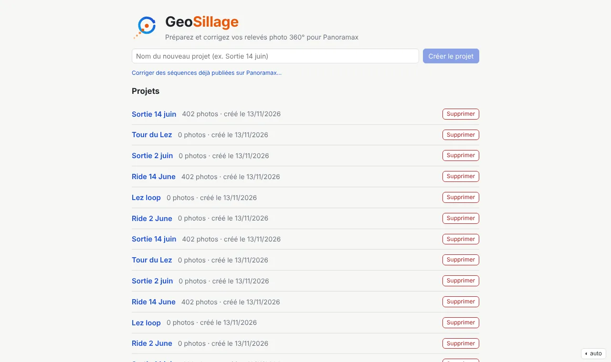
*Page d'accueil : création et liste des projets.*

**Les photos ne sont pas copiées** : le projet garde le chemin de chaque photo, les métadonnées lues et vos
corrections. Supprimer un projet ne touche pas aux photos.

**Importer** (bouton de la barre d'outils) : choisir un ou plusieurs dossiers ; les sous-dossiers sont parcourus
(`100GOPRO`, `101GOPRO`…). Pour naviguer : clic sur une ligne pour entrer dans le sous-dossier, clic sur un élément
du chemin (en haut) ou ↑ pour remonter, ou chemin saisi puis *Ouvrir* ; *+ Ajouter* (ou *Ajouter ce dossier*) le met
dans la liste à importer. Les photos du dossier ouvert sont affichées en gris sous les sous-dossiers, pour information
(l'import se fait par dossier). Une photo déjà importée n'est pas importée deux fois. L'import lit les EXIF puis crée les
miniatures en tâche de fond : la carte est utilisable avant la fin.

Onglet **Bilan** : nombre de photos, période, anomalies détectées :

| Anomalie | Signification |
|---|---|
| sans GPS | pas de position (début de sortie, tunnel) |
| saut GPS | position aberrante par rapport aux voisines (vitesse impossible) |
| doublon | même photo importée deux fois (même contenu) |
| interruption | trou de plus de 10 s dans la prise de vue (pause, changement de batterie) |
| illisible / introuvable | fichier abîmé, ou déplacé depuis l'import (*Vérifier les fichiers*) |


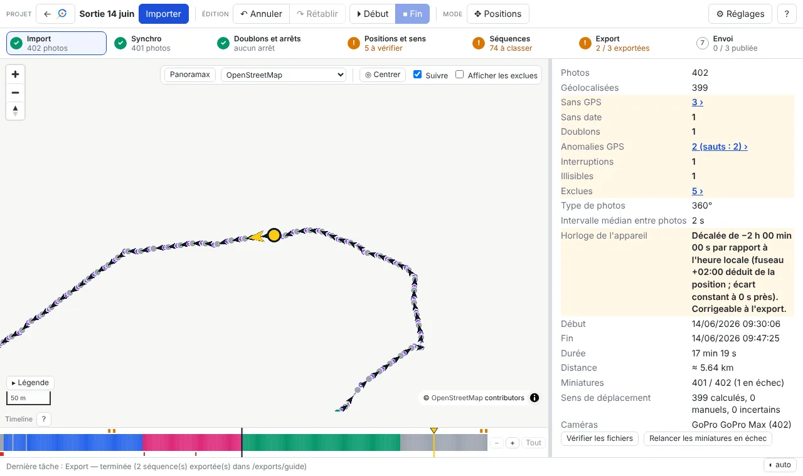
*Onglet *Bilan* : anomalies de la sortie (surlignées), réglage de la surcouche Panoramax, vérification des fichiers.*

Les photos sans GPS, sans date, en doublon, illisibles ou introuvables ne peuvent pas entrer dans une séquence.
L'onglet *Bilan* contient aussi le réglage de la surcouche Panoramax ([§ 3](#surcouche-panoramax)),
*Vérifier les fichiers* et, s'il y en a, *Relancer les miniatures en échec*.

---

## 3. L'écran

```
┌ barre d'outils : ← projets · Importer │ Annuler · Rétablir │ Couper · Début · Fin │ Positions … ⚙ Réglages · ?
├ étapes : Import · Synchro · Doublons et arrêts · Correction GPS · Séquences · Export · Envoi
├──────────────────────────────────────────────┬──────────────────────────────┐
│ carte                                        │ onglets :                    │
│ (Panoramax · fond · Centrer · Suivre · …)    │ Photo · Séquences · Synchro  │
│                                              │ Export et envoi · Bilan      │
├──────────────────────────────────────────────┤                              │
│ timeline (toute la sortie)                   │                              │
└──────────────────────────────────────────────┴──────────────────────────────┘
```

**⚙ Réglages** (barre d'outils) : les réglages généraux, dans une fenêtre — source de la surcouche Panoramax et
fonds de carte ajoutés (pour toutes les sorties ; *Retirer* supprime un fond ajouté, après confirmation), calcul du cap (distance
minimale et fenêtre de temps, pour ce projet ; *Enregistrer et recalculer*).

**Barre d'étapes** (sous la barre d'outils) : où en est la sortie, dans l'ordre de travail. Chaque étape est
**✓ verte** (rien à faire), **! orange** (quelque chose à reprendre, résumé à côté) ou **numérotée en gris** (pas
commencée) ; l'étape de l'onglet ouvert est encadrée. Au survol, le détail ; au clic, le bon endroit :

| Étape | Orange quand… | Clic |
|---|---|---|
| Import | — (gris tant qu'aucune photo) | *Bilan* |
| Synchro | — (grise tant qu'aucun décalage n'est appliqué ; verte avec le décalage et le nombre de photos placées) | *Synchro* |
| Doublons et arrêts | des arrêts restent à trier (les fichiers identiques sont écartés à l'import) | fenêtre *À corriger* : la liste des arrêts |
| Correction GPS | photos sans position, sauts GPS non corrigés, points à vérifier (écarts, précision GPS, caps) | fenêtre *À corriger* : problèmes, cause, correction ; un clic sur une photo y va (*Bilan* quand tout est vert) |
| Séquences | photos ni dans une séquence, ni exclues | fenêtre *À corriger* (photos non classées) ; onglet *Séquences* quand tout est vert |
| Export | séquences pas encore exportées, ou à réexporter | *Export* |
| Envoi | séquences pas encore publiées, modifiées depuis, ou envoi interrompu | *Export et envoi* (projet Panoramax : *Envoi*) |

Dans un projet Panoramax : Import Panoramax · Synchro · Doublons et arrêts · Correction GPS · Envoi (orange quand des
séquences ont été corrigées depuis leur import ou leur dernier envoi).


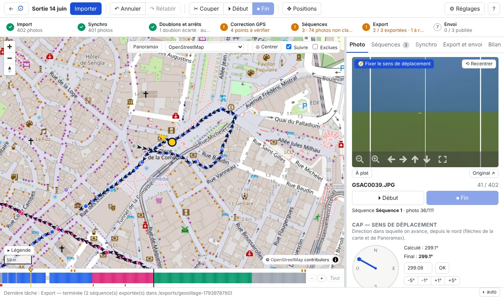
*Écran principal : carte (pastilles colorées par séquence, flèches de cap, photo courante en jaune), timeline en bas (une couleur par séquence, gris = non classées), visionneuse 360° et cap à droite.*

- **Carte** : une pastille par photo, colorée selon sa séquence (gris = non classée). À partir du zoom 15, une
  flèche montre le cap de chaque photo ; la photo courante est en jaune, et sa flèche tourne avec la direction
  regardée dans la visionneuse. Clic sur une pastille : aller à la photo ; Maj+clic : sélectionner une plage.
  - *Suivre* (coché par défaut) : la carte suit la photo courante ; décoché, elle reste fixe, *◎ Centrer* recentre.
  - *Exclues* : afficher les photos exclues (masquées par défaut).
- Les **réglages d'affichage de la carte** sont dans ses contrôles, en haut à droite : *Panoramax* (couverture
  déjà publiée, ci-dessous), fond de carte, *Centrer*, *Suivre*, *Exclues*.
- **Fond de carte** (liste des contrôles de la carte) : OpenStreetMap, Esri (satellite), **Satellite IGN Ortho** (France,
  ~20 cm, souvent le plus net), *IGN Ortho zoom max* (jusqu'au zoom 21 là où l'IGN a de la très haute résolution,
  vide ailleurs aux plus forts zooms), OpenTopoMap, ou un fond XYZ ajouté par vous (*+ Ajouter un fond XYZ…*).
- **Timeline** : toute la sortie, une case par photo, colorée par séquence ; trous = photos exclues, marques rouges
  = anomalies. Clic : aller à la photo ; **glisser** (au moins quelques pixels) ou Maj+clic : sélectionner une
  plage (en jaune). Une **pastille** en bas de la carte rappelle la sélection (« Photos a → b (n) · clic droit :
  actions », ou le début de séquence en cours) ; **désélectionner** : `Échap` ou son bouton ✕. **Survol** : bulle
  avec la miniature, le numéro, l'heure, la séquence et ce qui est à vérifier sur la photo. **Zoom** : molette sur la timeline (autour du curseur) ou boutons `−` / `+` /
  *Tout* à droite de la timeline ; la barre sous la
  timeline (ou Maj+molette, ou un glissement horizontal du pavé tactile) fait défiler ; la photo courante reste
  visible quand on navigue.
- **Légende** (bas gauche de la carte, repliable) : signification des couleurs et marques de la carte et de la
  timeline.
- **Onglet Photo** : visionneuse 360° (glisser pour regarder, molette pour zoomer, *À plat* pour l'image brute,
  *⟲ Recentrer* pour revenir face à l'avant), boutons *⏵ Début* / *⏹ Fin*, cap, position, et outils de la plage
  sélectionnée.

### Surcouche Panoramax

Bouton **Panoramax** (contrôles de la carte, en haut à droite) : affiche les photos 360° **déjà publiées**, pour voir ce qui manque ou ce qui est ancien.
Couleur selon l'âge : vert moins d'un an, orange 1 à 3 ans, rouge plus de 3 ans (rappelé dans la **Légende** de la
carte, groupe *Couverture Panoramax*, quand la couverture est affichée). Séquences visibles à partir du zoom 7,
photos à partir du zoom 15. Au survol : date, appareil, **auteur**.

Source (bouton **⚙ Réglages** de la barre d'outils) : **toutes les instances** (par défaut, méta-catalogue de panoramax.fr), OpenStreetMap
France, IGN, ou l'adresse d'une autre instance.

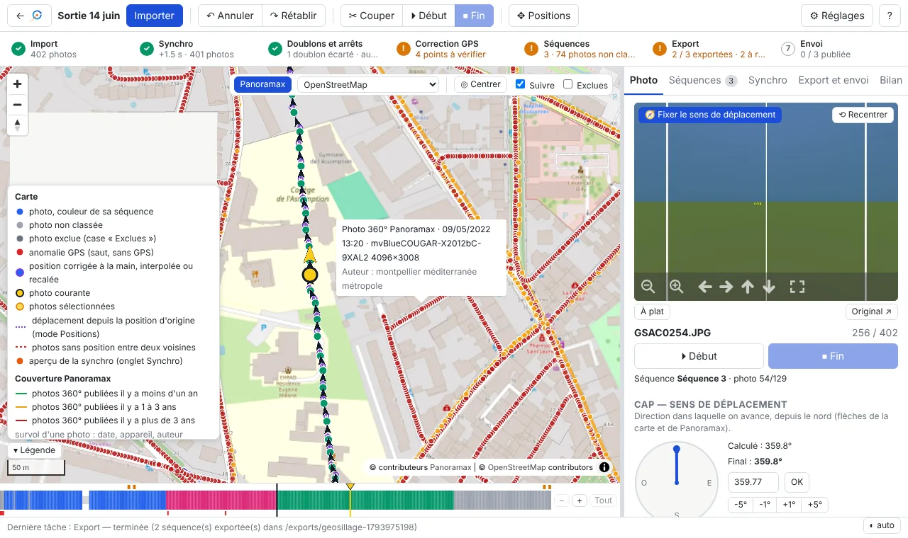
*Surcouche Panoramax (données réelles) : rouge = photos de plus de 3 ans, orange = 1 à 3 ans ; au survol, date, appareil et auteur.*

En rouvrant un projet, on retrouve la même photo, le même onglet et le même zoom de la timeline. La barre du bas
affiche les tâches en cours avec leur temps restant ; *🔔 Me prévenir à la fin des tâches* active une notification
du système quand un export, une publication ou un import se termine pendant que vous êtes dans une autre fenêtre.
Les actions importantes (exclure une plage, publier, envoyer des corrections) demandent une confirmation dans la
page : `Entrée` confirme, `Échap` annule.

---

## 4. Découper en séquences

Une séquence = un passage continu que l'on publiera d'un bloc. On parcourt la sortie photo par photo
(`←` `→`, Maj : par 10) dans la visionneuse ; plusieurs méthodes, combinables :

**Début / Fin (le plus simple)**
1. Sur la première photo de la séquence : `D` (*⏵ Début*).
2. Avancer avec `→` : la plage suit en jaune.
3. Sur la dernière photo : `F` (*⏹ Fin*) → la séquence est créée.
4. La photo suivante devient **aussitôt le début de la séquence suivante** : on continue d'avancer et on refait `F`
   à la fin de chaque séquence. `Échap` annule le début en cours.


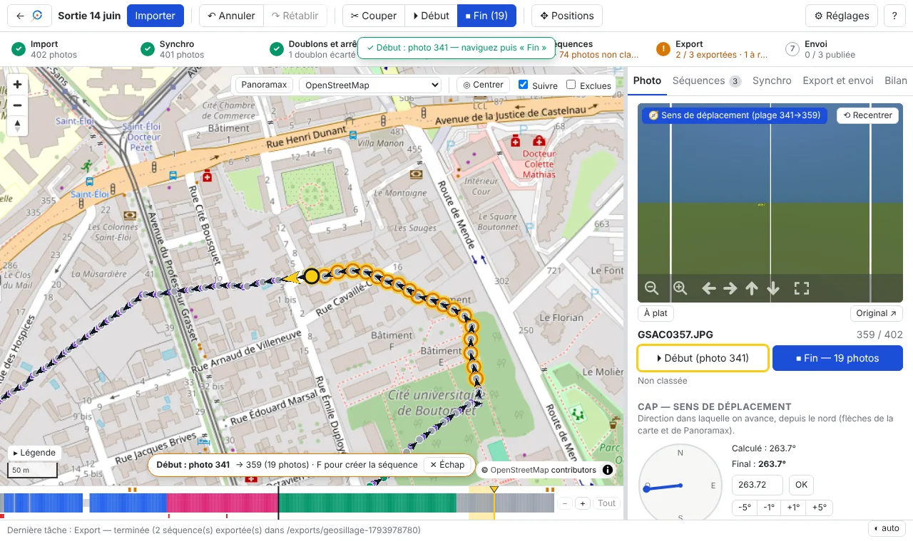
**Début* posé sur la photo 341 : la plage suit la navigation (en jaune sur la timeline), le bouton *Fin* indique le nombre de photos de la future séquence.*

**Couper** : `C` (*✂ Couper*) sur la première photo de chaque nouvelle séquence. Sur une photo non classée, la
séquence est d'abord créée autour d'elle, puis coupée : il suffit d'appuyer sur `C` à chaque coupure.

**Automatique** (onglet *Séquences*) :
- *Tout en séquences* : une séquence par bloc de photos non classées, à redécouper ensuite avec `C` ;
- *Découpage proposé* : coupe aux interruptions (> N s) et aux sauts de position (> N m), en ignorant les blocs
  trop courts ; cocher / décocher puis *Créer*.

**Depuis une plage** de la timeline : *Créer une séquence avec la plage* (ou `F`).

**Exclure des photos** (arrêts, feux rouges, photos ratées) : `X` ou `Suppr` exclut la photo courante et passe à la
suivante ; appuyer plusieurs fois exclut une série. Si la photo exclue était le *Début* en cours, le début passe à
la suivante. Avec une plage sélectionnée (et pas de début en cours), `X` exclut **toute la plage, après
confirmation** (le nombre de photos est indiqué). Les photos exclues :
- sont masquées sur la carte et sautées par `←` `→` (case *Exclues* pour les revoir) ;
- n'entrent dans aucune séquence et ne sont jamais exportées ;
- ne sont pas supprimées du disque. Pour en réintégrer une : cocher *Exclues*, aller dessus (ou cliquer son trou
  dans la timeline), `Maj+X`. Pour annuler une exclusion récente : `Ctrl+Z`.

**Modifier une séquence** (onglet *Séquences*) : clic sur le nom = aller au début ; double-clic ou *Renommer* ;
*Limites = plage* (la séquence devient la plage sélectionnée) ; *Fusionner avec la suivante* ; *Couper ici* ;
*Supprimer* (les photos redeviennent non classées). Les séquences au nom par défaut sont renumérotées dans l'ordre
de la sortie.


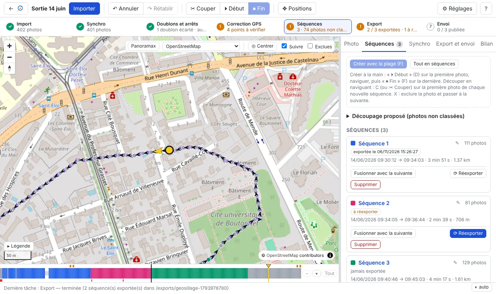
*Onglet *Séquences* : création, correction du montage de la caméra, découpage proposé, et pour chaque séquence son état d'export (*exportée*, *à réexporter*), sa durée, sa longueur, ses caps et ses actions.*

`Page ↑` / `Page ↓` passent d'une séquence à l'autre. **Tout est annulable** : `Ctrl+Z` / `Ctrl+Y`.

---

## 5. Corriger le retard GPS (onglet Synchro)

La GoPro enregistre la position avec 0,5 à 3 s de retard : chaque photo est placée un peu derrière l'endroit où elle
a été prise. On mesure ce retard une fois et on l'applique à toute la sortie.

1. Choisir un fond satellite (en France : *Satellite IGN Ortho*).
2. Trouver une photo où l'on voit un repère net, visible aussi sur la vue satellite (passage piéton, angle de
   bâtiment, ligne d'arrêt). Agrandir la photo (molette).
3. Faire glisser le **marqueur orange** sur la carte jusqu'à l'endroit réel de la photo : il ne peut aller que
   **le long de la trace**, et le décalage en secondes s'affiche ; les photos se décalent en aperçu (points
   orange) : exactement celles que *Appliquer* déplacerait, selon la portée choisie (toute la sortie, à partir de
   cette photo, séquence, plage) et la case *Garder les positions corrigées à la main*. La flèche jaune du
   marqueur montre la direction regardée dans la visionneuse (sens de la trace à cet endroit + vue) : tourner la
   vue vers un repère et vérifier que la flèche pointe dessus sur la carte.
4. Vérifier sur d'autres photos (`←` `→`). Enregistrer des **points de calage** sur plusieurs repères : la médiane
   est proposée.
5. *Appliquer* à toute la sortie (proposé par défaut pour la première synchronisation), à la séquence, à une plage,
   ou **à partir de la photo courante** jusqu'à la fin de la sortie.

**Retard qui change pendant la sortie** (par exemple 2 s sur les 100 premières photos, puis 1 s) : synchroniser
d'abord toute la sortie, puis aller là où le retard change et synchroniser à nouveau. Après une première
synchronisation, la portée proposée devient *À partir de cette photo* : les photos d'avant gardent leur décalage et
ne sont pas marquées *à réexporter*. La médiane proposée ne tient compte que des points de calage de la portée
choisie.

**Décalages appliqués** (onglet *Synchro*) : la liste des lots de photos synchronisés avec chaque décalage, par
exemple « Photos 1 → 100 (100) · +1.0 s », « Photos 101 → 700 (600) · +1.9 s », et les photos pas encore
synchronisées. Le lot de la photo courante est surligné ; *Voir* va à sa première photo. Une photo corrigée à la
main dans un lot ne le coupe pas (elle garde sa position) : elle est comptée à part.


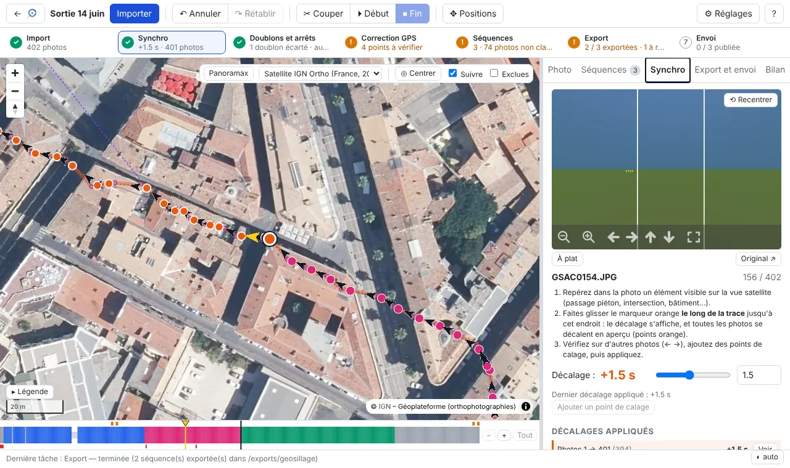
*Onglet *Synchro* sur le fond *Satellite IGN Ortho* : marqueur orange de la photo courante, positions décalées en aperçu (points orange) le long de la trace ; décalage en secondes à droite.*

Chaque photo est alors placée sur la trace à l'instant de prise de vue + décalage ; les photos en saut GPS ou sans
GPS reçoivent aussi une position. Les positions corrigées à la main sont gardées (option). Annulable.

Conseil : caler sur une portion où la trace suit bien la route. Si le GPS est décalé sur le côté (rue parallèle),
la projection sur la trace donne un décalage faux.

---

## 6. Corriger des positions

`M` (ou *✥ Positions*) active le mode Positions :
- **glisser le marqueur violet** de la photo courante à sa vraie place ;
- photo sans GPS : cliquer sur la carte pour la placer.


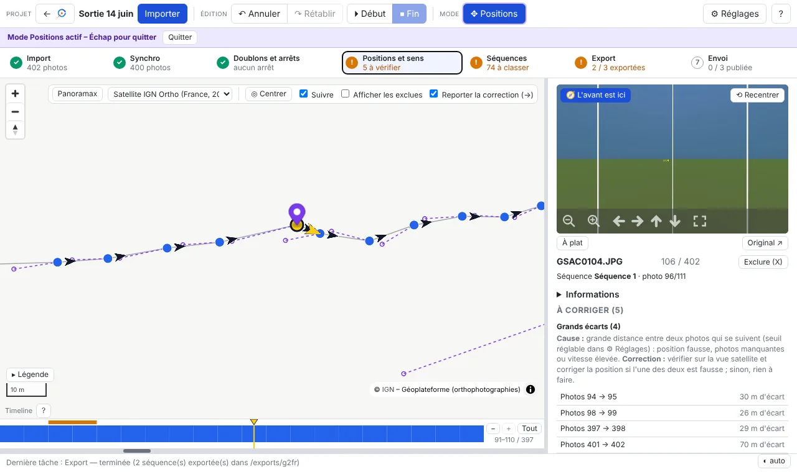
*Mode Positions : marqueur violet de la photo courante déplacé ; les pointillés relient chaque photo à sa position d'origine (petits cercles). Case *Reporter la correction (→)* en haut.*

La position d'origine reste visible (cercle violet et pointillés). Une photo en saut GPS corrigée redevient
utilisable (cap, séquences, export).

**Reporter la correction (→)** (case sur la carte en mode Positions, cochée par défaut) : après avoir déplacé un
point à la main, `→` déplace **de la même façon** la photo suivante, puis la suivante… Pratique pour une série de
photos décalées du même écart : on corrige la première, puis on avance. Le report s'applique aussi aux positions
synchronisées, mais jamais à une photo corrigée à la main. `←`, `Maj+→` et les clics ne reportent rien. Chaque
report affiche un message et s'annule avec `Ctrl+Z`. Décocher la case pour corriger les photos une à une.

### Recaler sur les voies OpenStreetMap

Le recalage est **indépendant du découpage des séquences**. Il s'ouvre par le **menu contextuel** (clic droit, ou
appui long sur un écran tactile) :
- sur une photo de la carte ou de la timeline : *Recaler cette photo*, ou *Recaler toute la séquence* de la photo ;
- sur une sélection (plage tracée sur la timeline, ou en cours avec *Début*) : *Recaler ces N photos* ; si aucune
  de ces photos n'est dans une séquence, le menu propose aussi **Créer une séquence avec ces photos** ;
- sur une séquence de l'onglet *Séquences* : *Recaler sur OpenStreetMap*.

Le recalage s'ouvre dans une **fenêtre flottante par-dessus la carte** : la carte reste visible (aperçu) et
utilisable autour ; la fenêtre se déplace par sa barre de titre et se ferme avec ✕ ou `Échap`.

Dans le panneau, choisir les photos à recaler : **la séquence** de la photo, **la plage de la timeline** (glisser
sur la timeline, ou Maj+clic), ou **des photos choisies** : `D` sur la première photo, avancer avec `→`, puis `F`
sur la dernière (ou les boutons *De cette photo* / *Jusqu'à cette photo*). Tant que la fenêtre de recalage est
ouverte, `D` / `F` choisissent les photos à recaler et ne touchent pas aux séquences ; fenêtre fermée, ils
redeviennent *Début* / *Fin* de séquence. Les photos concernées sont surlignées sur la carte (halo jaune et anneau orange) et sur la timeline. L'application récupère toutes les voies d'OpenStreetMap (rues, pistes cyclables, chemins, sentiers…) autour de la sélection (connexion
Internet nécessaire) et la découpe en tronçons :
- **voie évidente** : cochée d'office (« Rue de la Loge (rue) · 2,8 m en moyenne ») ;
- **plusieurs voies possibles** (piste cyclable le long d'une route, rues parallèles) : à choisir dans la liste ;
  survoler un choix surligne la voie en jaune sur la carte ; « Ne pas recaler ce tronçon » le laisse tel quel ;
- **aucune voie à moins de 15 m** : laissé tel quel.

L'aperçu montre les voies retenues en bleu foncé et le déplacement de chaque photo en pointillés. *Recaler N photos*
place chaque photo sur la voie choisie (position la plus proche) ; les photos placées à la main ne bougent pas
(case à décocher pour les inclure). Une seule opération, annulable avec `Ctrl+Z`.

### Photos sans position

Photos sans GPS (début de sortie, tunnel, perte du signal) : clic sur l'étape **Correction GPS** (fenêtre *À
corriger*, groupe *Photos sans position*), un élément par trou.
- Un clic sur un trou va à sa première photo : la carte montre, entourées en rouge et reliées en pointillés, la
  photo d'avant et celle d'après ; en mode Positions (`M`), cliquer sur la carte place la photo.
- *Interpoler entre les voisines* (encadré de l'onglet *Photo*) répartit les photos du trou entre la photo d'avant
  et celle d'après, selon l'heure de prise de vue (*Interpoler tous les trous possibles* dans la fenêtre). Impossible
  en début ou en fin de sortie (il manque un voisin) : les placer à la main ou les exclure.
- Une photo placée **rejoint la séquence de ses voisines** quand la photo d'avant et celle d'après sont dans la
  même séquence. Tout est annulable (`Ctrl+Z`).

La synchronisation (§ 5) place aussi les photos sans GPS qui tombent sur la trace ; les positions interpolées ou
placées à la main ne sont ensuite plus modifiées par une nouvelle synchronisation (option *Garder les positions
corrigées à la main*).

Onglet *Photo* : saisie des coordonnées, *Revenir à la position d'origine* ; sur une plage sélectionnée : décalage (m vers
l'est / le nord) ou déplacement le long du trajet.

---

## 7. Caps et orientation

Deux notions distinctes :

- le **cap** = le **sens de déplacement** (EXIF `GPSImgDirection`). Il est calculé automatiquement vers la photo
  suivante ; Panoramax s'en sert pour placer les flèches de navigation ;
- l'**orientation** = l'angle entre le **centre de l'image** et le sens de déplacement (XMP `PoseHeadingDegrees`).
  Elle vaut 0 quand la caméra regarde vers l'avant ; Panoramax s'en sert pour tourner la photo 360°.

Changer l'un ne change jamais l'autre. L'onglet *Photo* les présente en deux sections : **Cap — sens de
déplacement** (cadran, cap calculé et final) et **Orientation de la caméra**, avec un petit schéma vu de dessus :
le cap en bleu (depuis le nord), le centre de l'image en orange pointillé (décalé de l'orientation), et une phrase
comme « Centre de l'image à −35° du sens de déplacement (vers la gauche) ». *Remettre à 0°* annule l'orientation de
la photo.

### Vérifier les caps

Flèches sur la carte (zoom ≥ 15). Onglet *Photo* : cadran, `[` / `]` (±1°, Maj : ±5°), saisie d'un cap manuel, *Revenir au cap calculé*.
**Décalage du cap** (ajouté aux caps calculés) : sur **toute la sortie** (onglet *Bilan*, *Cap et orientation de
toute la sortie*) ou sur **une série de photos** (sélectionnée sur la timeline, puis clic droit *Décalage du cap (sens de déplacement)…*, ou
*Décaler* dans les outils de la plage de l'onglet *Photo*). La valeur remplace le décalage déjà posé sur ces
photos ; 0 le retire. Ce réglage ne dépend pas des séquences, qui ne sont qu'un découpage. Sur une plage, aussi
*Fixer* (même cap manuel pour toutes) et *Caps calculés*. Les caps manuels ne sont jamais écrasés ; un cap manuel voisin d'une position corrigée est marqué
« à revoir ».

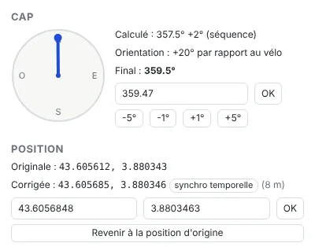
*Onglet *Photo* : cap calculé (avec son décalage éventuel), orientation de la photo par rapport au sens de déplacement, cap final ; position d'origine et position corrigée (ici par la synchro, 8 m).*

### Caméra sur casque

Le centre de l'image suit la tête, pas le sens de déplacement. Dans la visionneuse, tourner la vue vers l'avant
(la route ou le chemin devant soi), puis *🧭 Fixer le sens de déplacement* (sur la photo, ou sur toute la plage
sélectionnée). L'angle de la tête est enregistré comme orientation de la photo ; le cap reste le sens de déplacement, et la photo s'ouvre face à la route (dans
l'application comme sur Panoramax).

### Caméra mal orientée sur le casque, ou à l'envers

Champ d'angle et bouton **↻ Corriger le montage** :
- sur toutes les photos de la sortie (onglet *Bilan*, *Cap et orientation de toute la sortie*) ;
- sur une série de photos sélectionnée : clic droit *Orientation de la caméra…*, ou outils de la plage de l'onglet *Photo*.

Comme le décalage du cap, l'orientation ne dépend pas des séquences.

L'angle est **ajouté** à l'orientation de chaque photo : les angles de tête déjà fixés sont gardés. 180 = caméra
montée à l'envers. L'angle opposé revient en arrière, `Ctrl+Z` aussi. Vérifier le sens dans la visionneuse après
correction. Le fichier JPEG n'est jamais tourné : seule la balise d'orientation change.

### Points à vérifier avant de publier

Clic sur une étape orange de la barre d'étapes (*Doublons et arrêts*, *Correction GPS*, *Séquences*) : une **fenêtre
*À corriger*** s'ouvre sur la carte (déplaçable par sa barre de titre, `Échap` ou ✕ la ferme). Elle liste les
problèmes de l'étape, groupés par type avec leur **cause** et la **correction** à apporter ; un clic sur une photo
de la liste centre la carte dessus et la charge dans l'onglet *Photo*, la fenêtre restant ouverte pour enchaîner.
Les problèmes sont aussi marqués **en orange en haut de la timeline** :

- **Arrêts** : au moins 3 photos de suite au même endroit (moins de 2 m entre elles : feu rouge, pause). Choisir la
  ou les photos à garder — pas forcément la première : la plus nette, la mieux cadrée — et exclure les autres (`X`) ;
- **Grands écarts** : plus de 25 m entre deux photos qui se suivent (vitesse, photos manquantes, position fausse).
  Un trou laissé par des photos que vous avez exclues n'est pas signalé ;
- **Précision GPS faible** : la caméra indique une position peu précise (DOP > 5) ; vérifier la position sur la carte ;
- **Caps à vérifier** : cap saisi à la main à plus de 90° du cap calculé (erreur de saisie ?). Si c'est le cap
  calculé qui est faux (perte du GPS : la trace ne donne plus la bonne direction), **Ignorer** (dans la fenêtre *À
  corriger* ou l'encadré de l'onglet *Photo*) : le cap saisi est gardé et n'est plus signalé, tant qu'il ne change pas (`Ctrl+Z` annule).

Les valeurs ci-dessus sont celles par défaut : elles se règlent pour chaque projet dans **⚙ Réglages**, section
*Points à vérifier* (nombre de photos et distance d'un arrêt, grand écart, DOP, écart de cap).

L'onglet *Photo* sélectionne alors les photos concernées et affiche en haut un encadré
**« À corriger »** : quel est le problème, comment le corriger, et les boutons utiles (*Corriger la position (M)*,
*Interpoler entre les voisines*, *Revenir au cap calculé*, *Comparer les photos*, *Créer une séquence*, *Exclure*),
plus *Suivant (N)*. L'encadré disparaît quand on quitte ces photos ou avec ✕. **Rien n'est modifié
automatiquement** ; `N` / `Maj+N` passent au point suivant / précédent (avec aussi les sauts GPS, les photos sans
position et les photos non classées). Pour un arrêt, **Comparer** (ou un clic sur l'étape *Doublons et arrêts*)
affiche ses photos côte à côte ; un clic sur une vignette l'ouvre dans une visionneuse 360° (la direction
regardée est gardée d'une photo à l'autre, pour comparer le même détail) : cocher celles à garder (*Tout désélectionner* pour partir de zéro, *Tout garder* pour tout recocher), puis *Exclure n photos*
(une seule opération, `Ctrl+Z` l'annule) ; la liste se met à jour après chaque correction. Les sauts GPS et les photos sans position sont
listés dans la même fenêtre (étape *Correction GPS*), les photos non classées avec l'étape *Séquences*.

---

## 8. Exporter

Onglet **Export et envoi** :

1. **Dossier de destination** (*Parcourir…*), prérempli avec celui du dernier export. Avec Docker : sous
   `/exports` pour une copie.
2. **Mode** :
   - *Copier dans un dossier par séquence* (par défaut) : copies, photos sources intactes ;
   - *Déplacer les photos sources…* : les photos sont déplacées et renommées dans un dossier par séquence, EXIF
     modifiés ;
   - *Modifier les EXIF des photos sources sur place* : les fichiers ne bougent pas.

   Les deux derniers modes demandent confirmation. Avant toute modification, les valeurs d'origine des balises sont
   sauvegardées dans le projet : **Restaurer les photos sources** les remet, et ramène les fichiers à leur
   emplacement et à leur nom d'origine.
3. **Séquences à exporter** : sont cochées par défaut celles jamais exportées ou modifiées depuis leur dernier
   export. *Tout cocher* pour tout réexporter.
4. Options : *Compatibilité Panoramax* (cochée : un cap arrondi à 0° est écrit 0,6°, car Panoramax prend 0 pour
   « absent » et le recalculerait), *Exclure les photos en saut GPS non corrigées* (cochée : leur position est
   fausse).
5. *Exporter*. La tâche s'affiche en bas de l'écran.


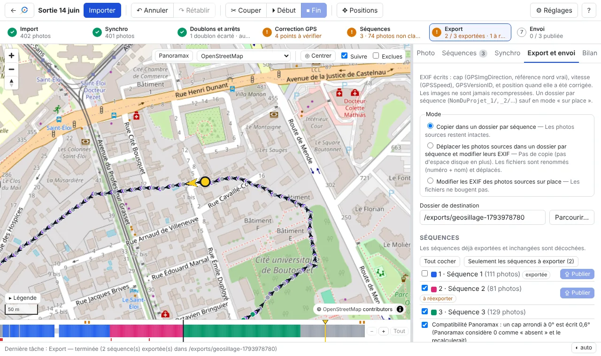
*Onglet *Export et envoi* : mode, dossier, séquences (la séquence 1, déjà exportée et inchangée, est décochée ; les séquences exportées ont leur bouton *⇪ Publier*) et options.*

Résultat : un dossier par séquence, `<nom du projet>_1`, `_2`… dans l'ordre de la sortie, avec les photos renommées
`0001_GSAC….JPG`, `0002_…`. Chaque photo reçoit :
- la position corrigée (si elle l'a été), le cap (`GPSImgDirection`), la vitesse ;
- l'orientation si elle a été fixée ou corrigée (avec un tangage / roulis de 0,01°, invisible, sans quoi Panoramax
  ignore l'orientation).

Exporter à nouveau dans le même dossier remplace l'export précédent du même projet ; un dossier non vide qui ne
vient pas de l'application est refusé (pour ne rien écraser). Aucune recompression : l'image elle-même n'est
jamais modifiée. Chaque fichier est relu après écriture et les écarts
sont signalés. Chaque dossier contient aussi `photos.csv`, un **rapport pour vous** (fichier source, position et son
origine, cap et son origine, orientation) : Panoramax n'en a pas besoin.

**Réexporter** : toute modification d'une séquence (photos, positions, caps, orientation, nom) la marque
*à réexporter* (onglets *Séquences* et *Export*). *⟳ Réexporter* (onglet *Séquences*) relance l'export de cette
seule séquence avec le dossier, le mode et les options de son dernier export.

**Photos exclues** : onglet *Export*, elles peuvent être déplacées dans un dossier `_exclues` (rien n'est supprimé ;
*Restaurer les photos sources* les remet).

---

## 9. Publier sur Panoramax

### Depuis l'application (onglet *Export et envoi*)

La publication se fait une fois la séquence exportée : section **Publier sur Panoramax** en bas de l'onglet pour la
connexion et les options, puis bouton **⇪ Publier** sur la ligne de la séquence, ou **⇪ Publier les n séquences
exportées non publiées** pour toutes à la fois.

1. **Instance** : adresse de l'instance Panoramax (par défaut `https://panoramax.openstreetmap.fr` ; IGN ou autre
   possible), puis *Changer*.
2. **Se connecter** : l'application affiche un lien *valider la connexion* ; l'ouvrir, se connecter sur le site de
   l'instance avec son compte habituel, puis revenir et cliquer *J'ai validé, vérifier* : « ✓ Connecté … en tant que
   … ». Aucun mot de passe n'est saisi dans l'application ; l'accès obtenu reste sur votre machine (dans le dossier
   des projets, lisible par vous seul) et n'est jamais affiché. *Se déconnecter* l'efface.
3. Choisir la **visibilité** (*Tout le monde*, ou *Moi seulement* pour un essai, modifiable ensuite sur Panoramax).
4. **Attributs de la séquence** (facultatifs, « sémantique » Panoramax) : le **mode de déplacement** (*À pied*,
   *Vélo*, *Voiture* — attribut `transport`, comme sur le site de Panoramax —, ou *Autre / non précisé* : pas
   d'attribut), et d'autres attributs libres, un par ligne au format `clé=valeur` (ex. `hashtag=gravel`). Ils sont
   copiés sur la séquence Panoramax et reproposés au prochain envoi.
5. Sur la ligne d'une séquence exportée : **⇪ Publier** (*Reprendre l'envoi* s'il a été interrompu, *Republier* si
   elle est déjà en ligne : cela crée une nouvelle séquence Panoramax), puis confirmer.
   Pour en publier plusieurs d'un coup : **⇪ Publier les n séquences exportées non publiées** (section *Publier sur
   Panoramax*) — une seule confirmation, qui liste les séquences, l'instance, la visibilité et les attributs ; elles
   sont envoyées l'une après l'autre (reprise des envois interrompus comprise).

Chaque séquence est envoyée depuis le dossier de son dernier export, comme **une seule séquence Panoramax** (ni
redécoupée, ni dédoublonnée). Une séquence modifiée depuis son export est d'abord réexportée. L'avancement s'affiche
en bas de l'écran ; après l'envoi, Panoramax traite les photos (floutage) : la publication est terminée quand la
séquence est prête. Un envoi interrompu (réseau coupé…) reprend où il s'était arrêté en relançant la publication.

Ensuite, onglets *Séquences* et *Export et envoi* : badge *publiée sur Panoramax* et lien *voir* (ouvre la première photo
sur le site de l'instance) ; *modifiée depuis la publication* si la séquence a changé depuis (corrections à
envoyer : voir ci-dessous).

### Corriger une séquence déjà publiée

Après publication, on peut encore corriger ici positions, caps et orientation (caméra mal réglée sur le casque…)
et **envoyer seulement les différences**, sans republier :

1. Onglet *Séquences*, sur la séquence : **Comparer avec Panoramax**. Résumé : « À envoyer : 111 photo(s) —
   2 position(s), 111 cap(s), 111 orientation(s) », photos exclues depuis, photos ajoutées depuis.
2. **Envoyer les corrections**, puis confirmer. Les photos exclues depuis la publication peuvent aussi être
   supprimées de Panoramax (case à cocher, définitif).
3. **Remettre les valeurs d'avant** renvoie les valeurs qu'avait Panoramax avant le dernier envoi (les photos
   supprimées ne reviennent pas).

Cette comparaison existe pour les séquences publiées **par l'application**. Pour des séquences déjà en ligne
(publiées autrement, ou anciennes), créer un **projet Panoramax** (ci-dessous).

### Projet Panoramax : corriger des séquences déjà en ligne

Un projet à part, sans photo sur le disque : les photos restent sur Panoramax et sont affichées depuis l'instance.

1. Page d'accueil : **Corriger des séquences déjà publiées sur Panoramax…**. Se connecter si besoin (même lien de
   validation que pour publier), cocher ses séquences dans la liste (titre, nombre de photos, date ; filtre par
   titre), ou coller l'adresse de séquences, puis **Créer le projet Panoramax**. Les photos sont chargées
   (positions, caps, orientation tels que sur Panoramax), puis leurs miniatures. La visionneuse affiche les
   photos comme Panoramax : orientation (lacet) et redressement de l'horizon (tangage, roulis) compris.
2. Corriger avec les outils habituels : positions (glisser, report →, synchro, recalage OSM, photos sans
   position), caps (le cap de départ est celui de Panoramax, marqué *Panoramax* ; *Revenir au cap calculé* le
   recalcule depuis la trace), orientation (*Fixer le sens de déplacement*, *Corriger le montage*), exclusion (`X`).
3. Onglet **Envoi** (pas d'onglet *Export*) : pour chaque séquence, *Comparer avec Panoramax*, *Envoyer les
   corrections* (seules les photos modifiées), *Remettre les valeurs d'avant*. Les photos exclues peuvent être
   supprimées de Panoramax (sur demande).

Dans un projet Panoramax, le découpage des séquences ne change pas (pas de *Début* / *Fin*, *Couper*, fusion…), et
il n'y a ni import de photos du disque, ni export. Le projet porte le badge *Panoramax* dans la liste.

Limites (celles de Panoramax) : les corrections sont enregistrées par l'instance (affichage, carte, données servies)
mais pas dans le fichier d'origine stocké sur Panoramax ; on ne peut ni ajouter de photos à une séquence publiée,
ni la couper ou la fusionner : il faut alors la republier.

### Avec d'autres outils

Envoyer chaque dossier exporté comme **une seule séquence**, sans que le serveur la redécoupe ni la dédoublonne :

- interface web de Panoramax : envoyer le contenu d'un dossier à la fois ;
- [CLI Panoramax](https://gitlab.com/panoramax/clients/cli) : commande `upload` avec `--no-split` et
  `--duplicates-checks disabled`.

Après publication, ne pas utiliser l'onglet « Régler l'orientation » de Panoramax sur ces séquences : il remplace le
cap de chaque photo par « direction de la trace + un angle fixe », et efface les caps et orientations préparés ici.
Si une séquence publiée est mal orientée, la corriger ici, réexporter et republier. Pour des photos déjà publiées sans
l'orientation lisible par Panoramax, l'outil [pan360-fixexif](https://github.com/qhess34/pan360-fixexif) corrige les
fichiers.

---

## 10. Raccourcis clavier

`?` affiche cette liste dans l'application. Les raccourcis ne fonctionnent pas quand un champ de saisie a le focus
(cliquer à côté).


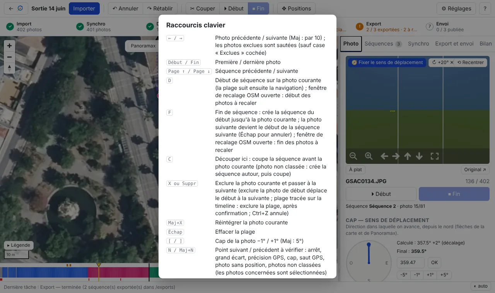
*Aide affichée par `?`.*

| Touche | Action |
|---|---|
| `←` / `→` | Photo précédente / suivante (Maj : par 10) ; les photos exclues sont sautées |
| `Début` / `Fin` | Première / dernière photo |
| `Page ↑` / `Page ↓` | Séquence précédente / suivante |
| `D` | Début de séquence sur la photo courante |
| `F` | Fin de séquence : crée la séquence ; la photo suivante devient le début de la suivante |
| `C` | Couper la séquence avant la photo courante |
| `X` / `Suppr` | Exclure la photo et passer à la suivante (plage sélectionnée : toute la plage, après confirmation) |
| `Maj+X` | Réintégrer la photo courante |
| `Échap` | Effacer la plage / le début en cours |
| `[` / `]` | Cap −1° / +1° (Maj : 5°) |
| `N` / `Maj+N` | Point suivant / précédent à vérifier (photos concernées sélectionnées) |
| `M` | Mode Positions |
| `Ctrl+Z` / `Ctrl+Y` | Annuler / rétablir |
| `?` | Aide |

---

## 11. Questions fréquentes

**J'ai exclu des centaines de photos sans le vouloir.** `Ctrl+Z` les réintègre d'un coup (une exclusion de plage
est une seule opération). C'est arrivé avec une plage sélectionnée sans le vouloir sur la timeline ; une
confirmation est désormais demandée.

**Mes photos d'origine sont-elles modifiées ?** Non en mode *Copier*. En modes *Déplacer* et *Sur place*, oui, mais
les valeurs d'origine sont sauvegardées et *Restaurer les photos sources* les remet.

**Les EXIF exportés sont-ils vraiment corrigés ?** Oui : chaque fichier est relu après écriture. Pour vérifier
vous-même :
`exiftool -n -GPSLatitude -GPSLongitude -GPSImgDirection -XMP-GPano:PoseHeadingDegrees fichier.jpg`.

**À quoi sert `photos.csv` ?** C'est un rapport lisible (d'où vient chaque photo, ce qui a été corrigé). Il n'est
pas nécessaire à Panoramax.

**Sur Panoramax, les flèches d'une séquence sont mal orientées alors que tout va bien dans l'application.**
Vérifier que la séquence a été publiée depuis un export récent (les premiers exports n'écrivaient pas l'orientation
comme Panoramax l'attend). Sinon, comparer pour une photo les valeurs `exiftool` ci-dessus avec celles affichées par
Panoramax.

**La surcouche Panoramax n'affiche rien.** Zoomer (séquences à partir du zoom 7, photos à partir du zoom 15) ;
vérifier la source dans l'onglet *Bilan*.

**Une nouvelle fonction annoncée n'apparaît pas.** Avec Docker : `git pull && docker compose up -d --build`, puis
recharger la page.

**La flèche `→` ne change pas de photo.** Un champ de saisie a le focus : cliquer sur la carte ou à côté.

**« [Violation] 'requestAnimationFrame' handler took … ms » dans la console du navigateur.** Simple avertissement
de performance de Chrome (dessin de la carte), sans conséquence.
