# User guide — GeoSillage

🇫🇷 [Version française](GUIDE_UTILISATEUR.md)

GeoSillage prepares the photos of a ride (bike — road, gravel, MTB —, on foot, by car…): **360° photos or smartphone photos** (Open Camera…), one photo about every 2 s, often thousands of them, before they are published on [Panoramax](https://panoramax.fr):

- split the ride into **sequences** and set aside useless photos (stops, duplicates, failed shots);
- fix the **GPS delay** of the camera and wrong **positions**;
- check the **headings** (direction of travel) and the camera **orientation** (helmet, upside-down camera);
- **export** one folder per sequence, with corrected EXIF that Panoramax reads properly;
- **publish** the sequences on Panoramax, with their attributes (mode of travel…).

Publishing is done from the application (one sequence = one upload), or with other tools (see [§ 9](#9-publishing-on-panoramax)). The interface exists in French and English (⚙ Settings, *Language*).

The screenshots in this guide were taken with a simulated ride near Montpellier: the photos are test images (colour bands), not real views. In the screenshots, some texts coming from the data stay in French (default sequence names « Séquence 1 », messages of past tasks).

Contents: [1. Install and run](#1-install-and-run) · [2. Projects](#2-projects) ·
[3. The screen](#3-the-screen) · [4. Splitting into sequences](#4-splitting-into-sequences) ·
[5. Fixing the GPS delay](#5-fixing-the-gps-delay-sync-tab) ·
[6. Fixing positions](#6-fixing-positions) · [7. Headings and orientation](#7-headings-and-orientation) ·
[8. Exporting](#8-exporting) · [9. Publishing on Panoramax](#9-publishing-on-panoramax) ·
[10. Keyboard shortcuts](#10-keyboard-shortcuts) · [11. FAQ](#11-faq)

---

## 1. Install and run

### With Docker (recommended)

```sh
git clone https://github.com/qhess34/geosillage.git && cd geosillage
cp .env.example .env          # set PHOTOS_DIR (your rides) and PUID/PGID (commands: id -u ; id -g)
mkdir -p data photos exports  # (or the folders set in .env): create them BEFORE the first launch
docker compose up -d --build
```

Then open <http://127.0.0.1:8765>. The application is only reachable from this machine (it gives access to the
mounted folders).

| In the application | On your machine (`.env`) | Role |
|---|---|---|
| `/photos` | `PHOTOS_DIR` | photos to import; destination of the *Move* / *In place* export modes |
| `/exports` | `EXPORTS_DIR` | exports in *Copy* mode |
| `/data` | `DATA_DIR` | projects (databases, thumbnails) |

**Update**: `git pull && docker compose up -d --build` — without `--build`, the old version keeps running. Stop:
`docker compose down` (projects stay in `DATA_DIR`).

### Without Docker (Linux)

Requirements: Python ≥ 3.11, Node.js ≥ 20, ExifTool (`sudo apt install libimage-exiftool-perl`).

```sh
./run.sh          # the first time: installs and builds the interface; then http://127.0.0.1:8765
```

A project created with Docker is used with Docker, and a project created with `run.sh` with `run.sh` (the photo
paths saved in the project are not the same).

---

## 2. Projects

**Picture type.** A ride contains a single type of pictures: **360°** or **flat** (smartphone…). The type is
detected at the first import from each picture's panorama XMP tags; the other type cannot be imported into the same
project afterwards (a message says so: create another ride). A 2:1 image without XMP tags is asked about: 360° or
flat? In a flat-picture project the viewer shows the plain image (no sphere view) and the orientation becomes the
**camera direction** (0° = forwards, 180° = backwards, ±90° = sideways). Pitch and roll read from the picture are
shown (read only). A Panoramax project follows the same rule (type from the field of view of the published pictures).
The **Summary** shows the median interval between pictures and warns you, with a link to *⚙ Settings*, when it is too
large for the thresholds (tuned for about 1 picture every 2 s).
It also compares the capture time with the pictures' GPS time: when the difference is constant, the *Camera clock*
row gives the shift (e.g. « +1 h 15 min 07 s ») and the time zone deduced from the position (the camera clock is
wrong, not the positions); when the difference changes, or when the GPS time of some pictures is stuck (out-of-date
position), the row says so.

A **project** = one ride (or several). Home page: type a name then *Create project*; open a project by clicking its name; *Delete*
(with confirmation).
The project name is used to name the exported folders (`<name>_1`, `<name>_2`…).

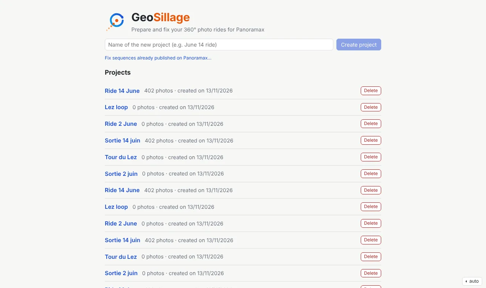
*Home page: creating and listing projects.*

**Photos are not copied**: the project keeps the path of each photo, the metadata read and your corrections.
Deleting a project does not touch the photos.

**Import** (toolbar button): choose one or several folders; sub-folders are scanned (`100GOPRO`, `101GOPRO`…). To
browse: click a row to enter the sub-folder, click an element of the path (at the top) or ↑ to go up, or type a path then *Open*;
*+ Add* (or *Add this folder*) puts it in the list to import. The photos of the open folder are shown in grey below the
sub-folders, for information (import is done by folder). A photo already imported is not imported twice. The import
reads the EXIF then creates the thumbnails in the background: the map is usable before it ends.

**Summary** tab: number of photos, period, anomalies detected:

| Anomaly | Meaning |
|---|---|
| no GPS | no position (start of the ride, tunnel) |
| GPS jump | position out of line with its neighbours (impossible speed) |
| duplicate | same photo imported twice (same content) |
| gap | hole of more than 10 s in the shooting (pause, battery change) |
| unreadable / missing | damaged file, or moved since the import (*Check the files*) |

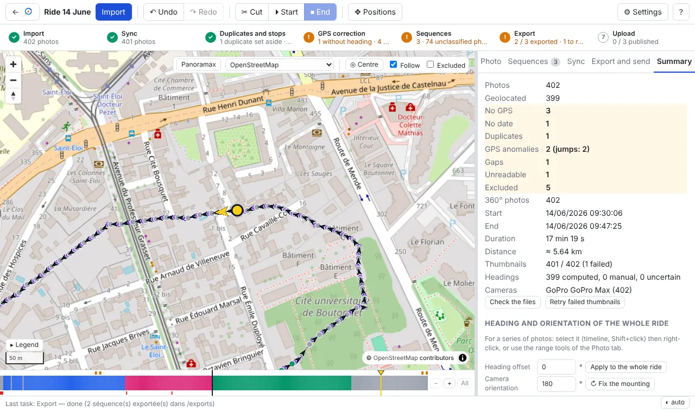
*Summary tab: anomalies of the ride (highlighted), file check, and heading and orientation settings for the whole ride.*

Photos without GPS, without date, duplicated, unreadable or missing cannot be part of a sequence.
The *Summary* tab also has *Check the files* and, if there are any, *Retry failed thumbnails*.

---

## 3. The screen

```
┌ toolbar: ← projects · Import │ Undo · Redo │ Start · End │ Positions mode … ⚙ Settings · ?
├ steps: Import · Sync · Duplicates and stops · Positions and direction · Sequences · Export · Upload
├──────────────────────────────────────────────┬──────────────────────────────┐
│ map                                          │ tabs:                        │
│ (Panoramax · background · Centre · Follow …) │ Photo · Sequences · Sync     │
│                                              │ Export and send · Summary    │
├──────────────────────────────────────────────┤                              │
│ timeline (the whole ride)                    │                              │
└──────────────────────────────────────────────┴──────────────────────────────┘
```

**⚙ Settings** (toolbar): the general settings, in a window — source of the Panoramax overlay and added background
maps (for all rides; *Remove* deletes an added background, after confirmation), heading computation (minimum distance and
time window, for this project; *Save and recompute*), thresholds of the *Points to check* (for this project) and the
interface **Language** (French or English; by default the browser's; it also applies to the server messages).

**Steps bar** (under the toolbar): where the ride stands, in working order. Each step is
**✓ green** (nothing to do), **! orange** (something to redo, summary next to it) or **numbered in grey** (not
started); the step of the open tab is framed. On hover, the detail; on click, the right place:

| Step | Orange when… | Click |
|---|---|---|
| Import | — (grey while there is no photo) | *Summary* |
| Sync | — (grey while no offset is applied; green with the number of photos synchronised, without the offset; offsets, which may differ from one batch of photos to another, are in the tab) | *Sync* |
| Duplicates and stops | stops remain to sort out (identical files are set aside on import) | *To fix* window: the list of stops |
| Positions and direction | photos without position, uncorrected GPS jumps, points to check (gaps, GPS accuracy, headings) | *To fix* window: problems, cause, fix; a click on a photo goes to it (*Summary* when all is green) |
| Sequences | photos neither in a sequence nor excluded | *To fix* window (unclassified photos); *Sequences* tab when all is green |
| Export | sequences not exported yet, or to re-export | *Export* |
| Upload | sequences not published yet, changed since, or an interrupted upload | *Export and send* (Panoramax project: *Send*) |

Subtitles are kept short to fit on one line at 1280 px ("5 to check", "2 to classify"); the detail (photos without
position, GPS jumps, duplicates set aside…) is in the tooltip. In the **Summary**, the orange rows that have a list
(positions, GPS anomalies, uncertain direction of travel, duplicates, excluded) are links: a click opens the matching
*To fix* list (for excluded photos, *Show excluded* gets ticked).

**First-launch tips**: when the first project is opened, a band of a few sentences sums up the workflow, the basic
gestures (right-click, `Ctrl+Z`, `?`) and what *Start* (begins a selection) and *End* (cuts the selection and puts a
new start) do. *Got it* closes it for good (remembered in the browser).

In a Panoramax project: Panoramax import · Sync · Duplicates and stops · Positions and direction · Upload (orange when
sequences have been corrected since their import or their last upload). The **Panoramax project** badge in the toolbar
(and the Summary) explains why the *Sequences* and *Export* steps and tabs are missing: no cutting or export, the photos
stay on the instance.

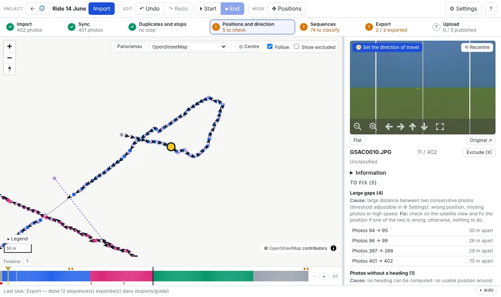
*Main screen: map (dots coloured by sequence, heading arrows, current photo in yellow), timeline at the bottom (one colour per sequence, grey = unclassified), 360° viewer and heading on the right.*

- **Map**: one dot per photo, coloured by sequence (grey = unclassified). From zoom 15, an arrow shows the heading
  of each photo; the current photo is yellow, and its arrow turns with the direction looked at in the viewer.
  Click on a dot: go to the photo; Shift+click: select a range.
  - *Follow* (ticked by default): the map follows the current photo; unticked, it stays fixed, *◎ Centre* recentres it.
  - *Show excluded*: show the excluded photos on the map and in the timeline (hidden by default).
- The **map display settings** are in its controls, top right: *Panoramax* (coverage already published, below),
  background map, *Centre*, *Follow*, *Show excluded*.
- **Background map** (list in the map controls): OpenStreetMap, Esri (satellite), **IGN Ortho satellite** (France,
  ~20 cm, often the sharpest), *IGN Ortho max zoom* (up to zoom 21 where IGN has very high resolution,
  empty elsewhere at the highest zooms), OpenTopoMap, or an XYZ background added by you (*+ Add an XYZ background…*).
- **Timeline** (labelled, with a **?** button to the shortcuts help): the whole ride, one cell per photo, coloured by sequence; holes = excluded photos, red marks
  = anomalies. Click: go to the photo; **drag** (at least a few pixels) or Shift+click: select a range (in yellow).
  A **chip** at the bottom of the map recalls the selection (« Photos a → b (n) · right-click: actions », or the
  sequence start in progress); **deselect**: `Esc` or its ✕ button. **Hover**: tooltip with the thumbnail, the number,
  the time, the sequence and what is to check on the photo. **Zoom**: wheel on the timeline (around the cursor) or the `−` / `+` /
  *All* buttons right of the timeline; the bar under the timeline (or Shift+wheel, or a horizontal touchpad swipe)
  scrolls; the current photo stays visible when you navigate.
- **Legend** (bottom left of the map, collapsible): meaning of the colours and marks of the map and the timeline.
- **Toolbar**: three named groups — *Project* (back, name, import), *Edit* (undo/redo, *Start*/*End*), *Mode* (*✥ Positions* toggle: a purple banner "Positions mode on – Esc to exit" stays visible while it is on).
- **Photo tab** (*Direction of travel*, *Camera orientation* and *Position* are collapsible sections whose state is remembered; *Start*/*End* are in the toolbar only): 360° viewer (drag to look around, wheel to zoom, *Flat* for the raw image, *⟲ Recentre* to face
  the front again), *⏵ Start* / *⏹ End* buttons, heading, position, and the tools of the selected range.

### Panoramax overlay

**Panoramax** button (map controls, top right): shows the 360° photos **already published**, to see what is missing or old.
Colour by age: green less than a year, orange 1 to 3 years, red more than 3 years (recalled in the map **Legend**,
*Panoramax coverage* group, when the coverage is shown). Sequences are visible from zoom 7, photos from zoom 15. On hover: date, camera, **author**.

Source (**⚙ Settings** button of the toolbar): **all instances** (default, panoramax.fr meta-catalogue), OpenStreetMap
France, IGN, or the address of another instance.

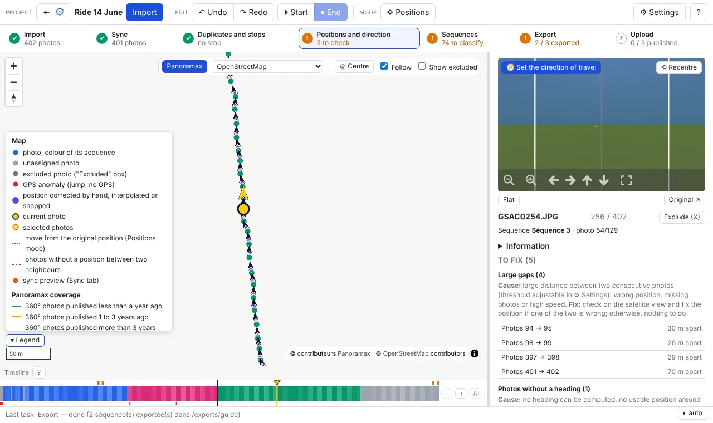
*Panoramax overlay (real data): red = photos more than 3 years old, orange = 1 to 3 years; on hover, date, camera and author.*

When you reopen a project, you find the same photo, the same tab and the same timeline zoom. The bottom bar shows
running tasks with their remaining time; *🔔 Notify me when tasks end* enables a system notification when an export,
a publication or an import ends while you are in another window. Important actions (excluding a range, publishing,
sending corrections) ask for confirmation in the page: `Enter` confirms, `Esc` cancels.

---

## 4. Splitting into sequences

A sequence = one continuous pass that you will publish as a block. You go through the ride photo by photo
(`←` `→`, Shift: by 10) in the viewer; several methods, which can be combined:

**Start / End (the simplest)**
1. On the first photo of the sequence: `D` (*⏵ Start*).
2. Move forward with `→`: the range follows in yellow.
3. On the last photo: `F` (*⏹ End*) → the sequence is created.
4. The next photo **immediately becomes the start of the next sequence**: keep moving forward and press `F` again
   at the end of each sequence. `Esc` cancels the start in progress.

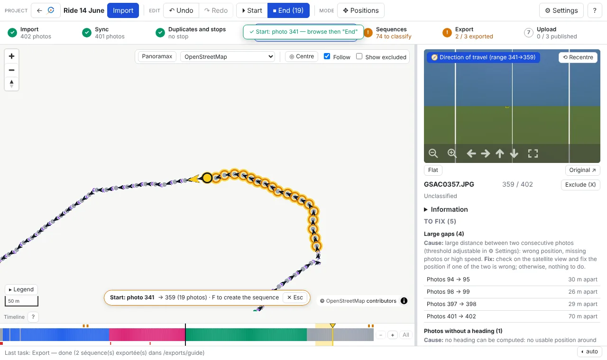
*Start* set on photo 341: the range follows the navigation (in yellow on the timeline), the *End* button shows the number of photos of the future sequence.*

**Cut**: `C` (*✂ Cut* button in the *Sequences* tab) on the first photo of each new sequence. On an unclassified photo, the sequence is first
created around it, then cut: just press `C` at each cut.

**Automatic** (*Sequences* tab):
- *All into sequences*: one sequence per block of unclassified photos, to cut afterwards with `C`;
- *Suggested cut*: cuts at gaps (> N s) and position jumps (> N m), ignoring blocks that are too short; tick / untick then *Create*.

**From a range** of the timeline: *Create from the range* (or `F`).

**Excluding photos** (stops, red lights, failed shots): `X` or `Del` excludes the current photo and moves to the
next; pressing several times excludes a series. If the excluded photo was the *Start* in progress, the start moves to
the next one. With a range selected (and no start in progress), `X` excludes **the whole range, after
confirmation** (the number of photos is shown). Excluded photos:
- are hidden on the map and in the timeline, and skipped by `←` `→` (*Show excluded* box to see them again; the
  timeline then shows them as holes);
- are part of no sequence and are never exported;
- are not deleted from the disk. To include one again: tick *Show excluded*, go to it (or click its hole in the
  timeline), `Shift+X`. To undo a recent exclusion: `Ctrl+Z`.

**Editing a sequence** (*Sequences* tab): click on the name = go to the start; double-click or *Rename*;
*Bounds = range* (the sequence becomes the selected range); *Merge with the next one*; *Cut here*;
*Delete* (the photos become unclassified again). Sequences with a default name are renumbered in ride order.

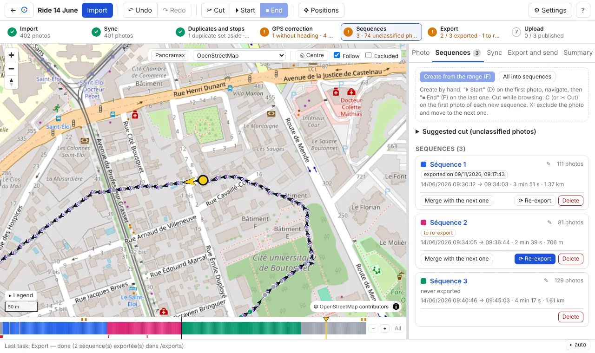
*Sequences tab: creation, suggested cut, and for each sequence its export state (*exported*, *to re-export*), duration, length, headings and actions.*

`Page Up` / `Page Down` move from one sequence to another. **Everything can be undone**: `Ctrl+Z` / `Ctrl+Y`.

---

## 5. Fixing the GPS delay (Sync tab)

A GoPro records the position with a 0.5 to 3 s delay: each photo is placed a little behind where it was
taken. You measure this delay once and apply it to the whole ride.

**Reference track** (top of the tab): by default the camera GPS. A **GPX** track recorded at the same time
(bike computer, watch, phone), often more accurate, can replace it: *Import a GPX…*, choose the file (it must be
timestamped). The application shows the number of points, the length, the period, the photos covered, and the
**time offset** detected between the photo time (the camera's local time) and the UTC time of the GPX — from the
camera positions, otherwise from the GPS time of the photos; *Edit* to correct it (in hours). The sync then places
each photo on the GPX at its time + the offset set below (a few seconds of clock difference). The radio buttons
go back to the camera GPS; *Remove the GPX* forgets it (the positions already applied stay).

1. Choose a satellite background (in France: *IGN Ortho satellite*).
2. Find a photo where you see a sharp landmark, also visible on the satellite view (pedestrian crossing, building
   corner, stop line). Enlarge the photo (wheel).
3. Drag the **orange marker** on the map to the real place of the photo: it can only move **along the track**, and the
   offset in seconds is shown; the photos shift in preview (orange dots): exactly those that *Apply* would move,
   depending on the chosen scope (whole ride, from this photo, sequence, range) and the *Keep positions corrected by
   hand* box. The yellow arrow of the marker shows the direction looked at in the viewer (direction of the track
   there + view): turn the view towards a landmark and check that the arrow points at it on the map.
4. Check on other photos (`←` `→`). Save **calibration points** on several landmarks: the median is
   suggested.
5. *Apply* to the whole ride (suggested by default for the first sync), to the sequence, to a range, or **from the
   current photo** to the end of the ride.

**Delay that changes during the ride** (for example 2 s on the first 100 photos, then 1 s): synchronise the whole
ride first, then go where the delay changes and synchronise again. After a first synchronisation, the suggested scope
becomes *From this photo*: the photos before keep their offset and are not marked *to re-export*. The median
suggested only takes into account the calibration points of the chosen scope.

**Applied offsets** (*Sync* tab): the list of batches of synchronised photos with each offset, for example
« Photos 1 → 100 (100) · +1.0 s », « Photos 101 → 700 (600) · +1.9 s », and the photos not yet
synchronised. The batch of the current photo is highlighted; *View* goes to its first photo. A photo corrected by
hand inside a batch does not split it (it keeps its position): it is counted separately.

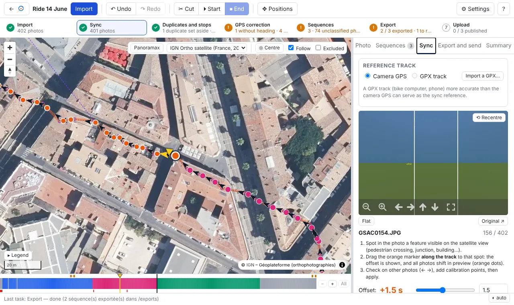
*Sync tab on the *IGN Ortho satellite* background: orange marker of the current photo, positions shifted in preview (orange dots) along the track; offset in seconds on the right.*

Each photo is then placed on the track at its shooting time + the offset; photos in a GPS jump or without GPS
also get a position. Positions corrected by hand are kept (option). Can be undone.

Tip: calibrate on a stretch where the track follows the road well. If the GPS is shifted sideways (parallel street),
the projection onto the track gives a wrong offset.

---

## 6. Fixing positions

`M` (or *✥ Positions*) turns on Positions mode:
- **drag the purple marker** of the current photo to its real place;
- photo without GPS: click on the map to place it.

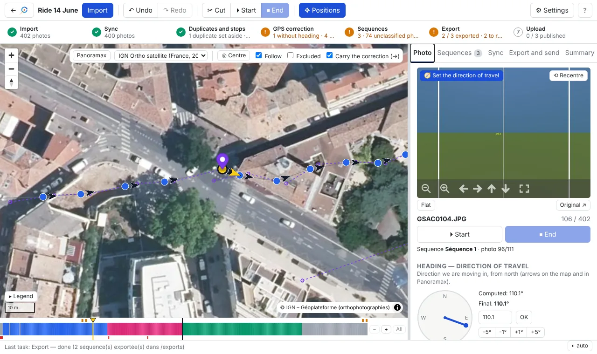
*Positions mode: purple marker of the current photo moved; dotted lines link each photo to its original position (small circles). *Carry the correction (→)* box at the top.*

The original position stays visible (purple circle and dotted line). A photo in a GPS jump that has been corrected
becomes usable again (heading, sequences, export).

**Carry the correction (→)** (box on the map in Positions mode, ticked by default): after moving a point by hand,
`→` moves the next photo **in the same way**, then the next… Handy for a series of photos shifted by the same gap:
correct the first, then move forward. The carry also applies to synchronised positions, but never to a photo
corrected by hand. `←`, `Shift+→` and clicks carry nothing. Each carry shows a message and is undone with `Ctrl+Z`.
Untick the box to correct photos one by one.

### Snapping onto OpenStreetMap ways

Snapping is **independent of the split into sequences**. It opens from the **context menu** (right-click, or long
press on a touch screen):
- on a photo of the map or the timeline: *Snap this photo to OpenStreetMap…*, or *Snap the whole sequence “name”…*;
- on a selection (range drawn on the timeline, or in progress with *Start*): *Snap these N photos to OpenStreetMap…*; if none of these
  photos is in a sequence, the menu also offers **Create a sequence with these N photos**;
- on a sequence in the *Sequences* tab: *Snap to OpenStreetMap…* (sequence menu).

Snapping opens in a **floating window over the map**: the map stays visible (preview) and usable around it; the
window moves by its title bar and closes with ✕ or `Esc`.

In the panel, choose the photos to snap: **the sequence** of the photo, **the timeline range** (drag on the
timeline, or Shift+click), or **chosen photos**: `D` on the first photo, move forward with `→`, then `F` on the last
one (or the *From this photo* / *Up to this photo* buttons). While the snapping window is open, `D` / `F` choose the
photos to snap and do not touch the sequences; with the window closed, they are *Start* / *End* of sequence again.
The photos concerned are highlighted on the map (yellow halo and orange ring) and on the timeline. The application
fetches all OpenStreetMap ways (streets, cycle paths, tracks, trails…) around the selection (Internet connection
needed) and cuts them into stretches:
- **obvious way**: ticked automatically (« Rue de la Loge (street) · 2.8 m on average »);
- **several possible ways** (cycle path along a road, parallel streets): to choose in the list; hovering a choice
  highlights the way in yellow on the map; « Do not snap this stretch » leaves it as is;
- **no way within 15 m**: left as is.

The preview shows the ways kept in dark blue and the move of each photo as dotted lines. *Snap N photos* places
each photo on the chosen way (closest position); photos placed by hand do not move (box to untick to include
them). A single operation, undone with `Ctrl+Z`.

### Snapping onto the GPX line

With an imported GPX track (*Sync* tab): *Snap photos onto the GPX line…* (*Sync* tab), or right-click on a range / a
sequence → *Snap … to the GPX track…*. Each photo of the chosen range (photos N → M, a sequence or the whole
ride) is moved onto the closest point of the GPX line, **ignoring the time** (unlike the sync); those farther than
the maximum distance (30 m by default) do not move, positions corrected by hand are kept (box to untick). The window
moves by its title bar; the map shows the GPX track in grey and the **preview** of the moves as blue dotted lines,
with the number of photos moved, the mean and maximum move, recomputed at each setting. *Snap N photos* applies: a
single operation, `Ctrl+Z` undoes it.

### Photos without position

Photos without GPS (start of the ride, tunnel, signal loss): click on the **Positions and direction** step (*To fix* window,
*Photos without a position* group), one item per gap.
- A click on a gap goes to its first photo: the map shows, circled in red and linked by dotted lines, the photo
  before and the one after; in Positions mode (`M`), clicking on the map places the photo.
- *Interpolate between neighbours* (box of the *Photo* tab) spreads the photos of the gap between the photo before
  and the one after, according to the shooting time (*Interpolate every possible gap* in the window). Impossible at
  the start or end of the ride (a neighbour is missing): place them by hand or exclude them.
- A placed photo **joins the sequence of its neighbours** when the photo before and the one after are in the same
  sequence. Everything can be undone (`Ctrl+Z`).

The sync (§ 5) also places the photos without GPS that fall on the track; interpolated or hand-placed positions are
then no longer changed by a new sync (option *Keep positions corrected by hand*).

*Photo* tab: entering coordinates, *Back to the original position*; on a selected range: offset (m towards the
east / north) or move along the route.

---

## 7. Headings and orientation

Two distinct notions:

- the **heading** = the **direction of travel** (EXIF `GPSImgDirection`). It is computed automatically towards the
  next photo; Panoramax uses it to place the navigation arrows;
- the **orientation** = the angle between the **image centre** and the direction of travel (XMP
  `PoseHeadingDegrees`). It is 0 when the camera looks forward; Panoramax uses it to turn the 360° photo.

Changing one never changes the other. The *Photo* tab presents them in two sections: **Heading — direction of
travel** (dial, computed and final heading) and **Camera orientation**, with a small top-view diagram: the heading in
blue (from north), the image centre as an orange dotted line (shifted by the orientation), and a sentence such as
« Image centre at −35° from the direction of travel (to the left) ». *Reset to 0°* cancels the orientation of the photo.

**Heading source** (*Summary* tab or *⚙ Settings*, for the whole ride): *Computed from the track*, or *Camera's
heading* (compass, `GPSImgDirection` recorded by the camera or smartphone). At the first import the camera's heading
is chosen when it is present, non-zero and varying along the ride; otherwise it is computed. Photos without a camera
heading keep the computed one. `Ctrl+Z` undoes the change.

**Flat pictures.** Heading and camera direction are set as for 360° (photo, range, whole ride). On export (and in the
corrections sent to Panoramax), the `GPSImgDirection` written is the camera direction: heading + camera direction
(180° = camera facing backwards) when the heading is computed from the track, the camera's heading as is otherwise.
No panorama tag (XMP-GPano) is written, and only positions and headings are sent to Panoramax.

### Checking headings

Arrows on the map (zoom ≥ 15). At a stop (red light, pause), the computed heading is the direction of arrival at the
stop (otherwise that of departure): the photo kept from a stop therefore always has a heading. *Photo* tab: dial, `[` / `]` (±1°, Shift: ±5°), entering a manual heading, *Back to the computed heading*.
**Direction-of-travel offset** (added to the computed headings): on the **whole ride** (*Summary* tab, *Direction of travel and orientation of
the whole ride*) or on **a series of photos** (selected on the timeline, then right-click *Direction-of-travel offset of these N photos…*, or
*Shift* in the range tools of the *Photo* tab). The value replaces the offset already set on these photos; 0
removes it. This setting does not depend on sequences, which are only a split. On a range, also *Set* (same manual
heading for all) and *Computed headings*. Manual headings are never overwritten; a manual heading next to a corrected position is marked
« to review ».

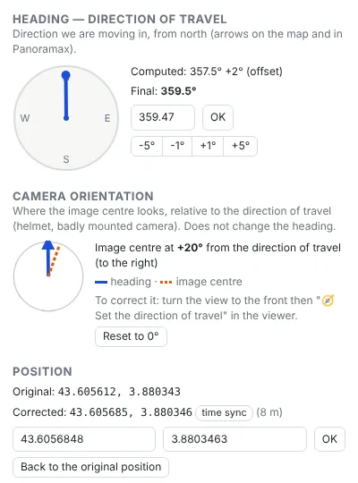
*Photo* tab: computed heading (with its offset if any), orientation of the photo relative to the direction of travel, final heading; original position and corrected position (here by the sync, 8 m).*

### Camera on a helmet

The image centre follows the head, not the direction of travel. In the viewer, turn the view to the front (the
road or path ahead), then *🧭 Front is here* (on the photo, or on the whole selected range). The head
angle is saved as the orientation of the photo; the heading stays the direction of travel, and the photo opens facing
the road (in the application as on Panoramax).

### Camera badly aligned on the helmet, or upside down

Angle field and **↻ Fix the mounting** button:
- on all the photos of the ride (*Summary* tab, *Direction of travel and orientation of the whole ride*);
- on a selected series of photos: right-click *Camera orientation of these N photos…*, or the range tools of the *Photo* tab.

Like the heading offset, the orientation does not depend on sequences.

The angle is **added** to the orientation of each photo: head angles already set are kept. 180 = camera mounted
upside down. The opposite angle goes back, as does `Ctrl+Z`. Check the direction in the viewer after correcting. The
JPEG file is never rotated: only the orientation tag changes.

### Points to check before publishing

Click on an orange step of the steps bar (*Duplicates and stops*, *Positions and direction*, *Sequences*): a **« To fix »
window** opens over the map (movable by its title bar, closed by `Esc` or ✕). It lists the problems of the step,
grouped by type with their **cause** and the **fix** to apply; a click on a photo in the list centres the map on it
and loads it in the *Photo* tab, the window staying open so you can go on.
The problems are also marked **in orange at the top of the timeline**:

- **Stops**: at least 3 photos in a row at the same place (less than 2 m between them: red light, pause). Choose the
  photo(s) to keep — not necessarily the first: the sharpest, the best framed — and exclude the others (`X`);
- **Large gaps**: more than 25 m between two consecutive photos (speed, missing photos, wrong position).
  A hole left by photos you excluded is not reported;
- **Low GPS accuracy**: the camera reports a poorly accurate position (DOP > 5); check the position on the map;
- **Headings to check**: heading entered by hand more than 90° from the computed heading (typing error?). If it is
  the computed heading that is wrong (GPS loss: the track no longer gives the right direction), **Ignore** (in the *To
  fix* window or the box of the *Photo* tab): the entered heading is kept and no longer reported, as long as it does not change (`Ctrl+Z` undoes);
- **Photos without heading** (*Positions and direction* step): positioned photo with no final heading, neither computed nor
  entered — no usable position around (neighbours without position or in a GPS jump), or camera motionless over the
  whole stretch. Without a heading, Panoramax cannot orient the photo: fix the neighbouring positions (the heading is
  recomputed), enter the heading by hand (*Heading* section of the *Photo* tab), or exclude.

The values above are the defaults: they are set for each project in **⚙ Settings**, *Points to check* section
(number of photos and distance of a stop, large gap, DOP, heading difference).

The *Photo* tab then selects the photos concerned and shows at the top a **« To fix »** box: what the problem is, how
to fix it, and the useful buttons (*Fix the position (M)*, *Interpolate between neighbours*, *Back to the computed
heading*, *Compare the photos*, *Create a sequence*, *Exclude*), plus *Next (N)*. The box disappears when you leave
these photos or with ✕. **Nothing is modified automatically**; `N` / `Shift+N` go to the next / previous point (also
including GPS jumps, photos without position and unclassified photos). For a stop, the map first lists its photos
(with 3 neighbours on each side: time, distance from the previous one): *Start* / *End* ◀ ▶, *+ Add* or *− Remove*
adjust the photos of the stop, always contiguous and selected on the map and the timeline; a click on a row shows the
photo. **Compare these n photos** then shows its photos side by side; a click on a thumbnail opens it in a 360°
viewer (the direction looked at is kept from one photo to another, to compare the same detail): tick those to keep
(*Deselect all* to start from zero, *Keep all* to tick everything again; none ticked: all are excluded), then *Exclude n photos*
(a single operation, `Ctrl+Z` undoes it); the list updates after each fix. GPS jumps and photos without position are
listed in the same window (*Positions and direction* step), unclassified photos with the *Sequences* step.

---

## 8. Exporting

**Export and send** tab:

1. **Destination folder** (*Browse…*), prefilled with that of the last export. With Docker: under
   `/exports` for a copy.
2. **Mode**:
   - *Copy into one folder per sequence* (default): copies, source photos untouched;
   - *Move the source photos into one folder per sequence and edit their EXIF*: the photos are moved and renamed
     into one folder per sequence, EXIF modified;
   - *Edit the EXIF of the source photos in place*: the files do not move.

   The last two modes ask for confirmation. Before any change, the original values of the tags are saved in the
   project: **Restore source photos** puts them back, and returns the files to their original location and name.
3. **Sequences**: ticked by default are those never exported or modified since their last export. *Tick all* to
   re-export everything.
4. Options: *Panoramax compatibility* (ticked: a heading rounded to 0° is written 0.6°, because Panoramax treats 0 as
   « missing » and would recompute it), *Exclude photos in an uncorrected GPS jump* (ticked: their position is wrong), *Correct the capture time* (offered and ticked when the camera clock is off by a constant amount: the
   export writes `DateTimeOriginal` and `OffsetTimeOriginal` without the shift; the original value is saved and put
   back by the restoration of the sources).
5. *Export*. The task is shown at the bottom of the screen.

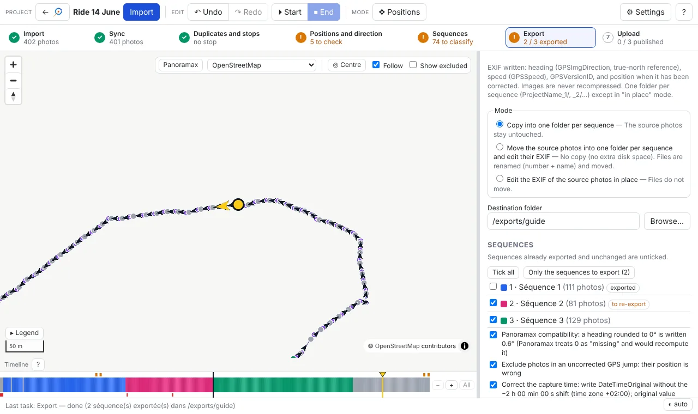
*Export and send tab: mode, folder, sequences (sequence 1, already exported and unchanged, is unticked; exported sequences have their *⇪ Publish* button) and options.*

Result: one folder per sequence, `<project name>_1`, `_2`… in ride order, with the photos renamed
`0001_GSAC….JPG`, `0002_…`. Each photo gets:
- the corrected position (if it was corrected), the heading (`GPSImgDirection`), the speed;
- the orientation if it was set or corrected (with a pitch / roll of 0.01°, invisible, without which Panoramax
  ignores the orientation).

Exporting again into the same folder replaces the previous export of the same project; a non-empty folder that does
not come from the application is refused (so that nothing is overwritten). No recompression: the image itself is
never modified. Each file is read back after writing and differences are reported. Each folder also contains
`photos.csv`, a **report for you** (source file, position and its origin, heading and its origin, orientation):
Panoramax does not need it.

**Re-exporting**: any change to a sequence (photos, positions, headings, orientation, name) marks it
*to re-export* (*Sequences* and *Export* tabs). *⟳ Re-export* (*Sequences* tab) restarts the export of that sequence
alone with the folder, mode and options of its last export.

**Excluded photos**: *Export* tab, they can be moved into a `_exclues` folder (nothing is deleted;
*Restore source photos* puts them back).

---

## 9. Publishing on Panoramax

### From the application (*Export and send* tab)

Publishing is done once the sequence is exported: **Publish on Panoramax** section at the bottom of the tab for the
connection and the options, then the **⇪ Publish** button on the sequence row, or **⇪ Publish the n exported,
unpublished sequences** for all at once.

1. **Instance**: address of the Panoramax instance (default `https://panoramax.openstreetmap.fr`; IGN or another
   possible), then *Change*.
2. **Log in**: the application shows a *confirm the connection* link; open it, log in on the instance website with
   your usual account, then come back and click *I've confirmed, check*: « ✓ Connected to … as … ». No password is typed in
   the application; the access obtained stays on your machine (in the projects folder, readable by you only) and is never
   shown. *Log out* erases it.
3. Choose the **visibility** (*Everyone*, or *Only me* for a trial, which can be changed later on Panoramax).
4. **Sequence attributes** (optional, Panoramax « semantics »): the **mode of travel** (*On foot*, *Bicycle*, *Car* —
   `transport` attribute, as on the Panoramax site —, or *Other / unspecified*: no attribute), and other free
   attributes, one per line in `key=value` format (e.g. `hashtag=gravel`). They are copied to the Panoramax sequence
   and offered again at the next upload.
5. On the row of an exported sequence: **⇪ Publish** (*Resume upload* if it was interrupted, *Republish* if it is
   already online: this creates a new Panoramax sequence), then confirm.
   To publish several at once: **⇪ Publish the n exported, unpublished sequences** (*Publish on Panoramax* section) —
   a single confirmation, listing the sequences, the instance, the visibility and the attributes; they are sent one
   after the other (interrupted uploads resumed included).

Each sequence is sent from the folder of its last export, as **one single Panoramax sequence** (neither split nor
deduplicated). A sequence changed since its export is re-exported first. Progress is shown at the bottom of the
screen; after the upload, Panoramax processes the photos (blurring): the publication is finished when the sequence is
ready. An interrupted upload (network cut…) resumes where it stopped when you restart the publication.

Afterwards, *Sequences* and *Export and send* tabs: *published on Panoramax* badge and *View* link (opens the first
photo on the instance website); *changed since publication* if the sequence has changed since (corrections to send:
see below).

### Correcting an already published sequence

After publication, you can still correct positions, headings and orientation here (camera badly set on the helmet…)
and **send only the differences**, without republishing:

1. *Sequences* tab, on the sequence: **Compare with Panoramax**. Summary: « To send: 111 photo(s) —
   2 position(s), 111 heading(s), 111 orientation(s) », photos excluded since, photos added since.
2. **Send the corrections**, then confirm. Photos excluded since the publication can also be deleted from Panoramax
   (box to tick, permanent).
3. **Put back the previous values** sends again the values Panoramax had before the last upload (deleted photos do not
   come back).

This comparison exists for sequences published **by the application**. For sequences already online (published
otherwise, or old), create a **Panoramax project** (below).

### Panoramax project: correcting sequences already online

A separate project, without photos on the disk: the photos stay on Panoramax and are displayed from the instance.

1. Home page: **Fix sequences already published on Panoramax…**. Log in if needed (same confirmation link as for
   publishing), tick your sequences in the list (title, number of photos, date; filter by title), or paste the
   address of sequences, then **Create the Panoramax project**. The photos are loaded (positions, headings,
   orientation as on Panoramax), then their thumbnails. The viewer shows the photos like Panoramax: orientation (yaw)
   and horizon levelling (pitch, roll) included.
2. Correct with the usual tools: positions (drag, carry →, sync, OSM snapping, photos without position), headings
   (the starting heading is Panoramax's, marked *Panoramax*; *Back to the computed heading* recomputes it from the
   track), orientation (*Front is here*, *Fix the mounting*), exclusion (`X`).
3. **Send** tab (no *Export* tab): for each sequence, *Compare with Panoramax*, *Send the corrections* (only the
   modified photos), *Put back the previous values*. Excluded photos can be deleted from Panoramax (on request).

In a Panoramax project, the split into sequences does not change (no *Start* / *End*, *Cut*, merge…), and
there is no import of photos from the disk, nor export. The project carries the *Panoramax* badge in the list.

Limits (those of Panoramax): corrections are saved by the instance (display, map, data served) but not in the
original file stored on Panoramax; you cannot add photos to a published sequence, nor cut or merge it: it must then be
republished.

### With other tools

Send each exported folder as **one single sequence**, without the server splitting or deduplicating it:

- Panoramax web interface: send the content of one folder at a time;
- [Panoramax CLI](https://gitlab.com/panoramax/clients/cli): `upload` command with `--no-split` and
  `--duplicates-checks disabled`.

After publication, do not use the « Set the orientation » tab of Panoramax on these sequences: it replaces the heading
of each photo by « direction of the track + a fixed angle », and erases the headings and orientations prepared here.
If a published sequence is badly oriented, fix it here, re-export and republish. For photos already published without
the orientation Panoramax can read, the [pan360-fixexif](https://github.com/qhess34/pan360-fixexif) tool fixes the files.

---

## 10. Keyboard shortcuts

`?` shows this list in the application. Shortcuts do not work while an input field has focus (click elsewhere).

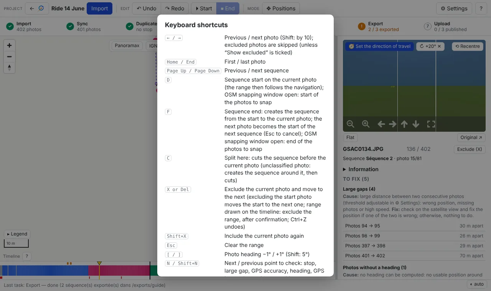
*Help shown by `?`.*

| Key | Action |
|---|---|
| `←` / `→` | Previous / next photo (Shift: by 10); excluded photos are skipped |
| `Home` / `End` | First / last photo |
| `Page Up` / `Page Down` | Previous / next sequence |
| `D` | Sequence start on the current photo |
| `F` | Sequence end: creates the sequence; the next photo becomes the start of the next one |
| `C` | Cut the sequence before the current photo |
| `X` / `Del` | Exclude the photo and move to the next (range selected: the whole range, after confirmation) |
| `Shift+X` | Include the current photo again |
| `Esc` | Clear the range / the start in progress |
| `[` / `]` | Heading −1° / +1° (Shift: 5°) |
| `N` / `Shift+N` | Next / previous point to check (photos concerned selected) |
| `M` | Positions mode |
| `Ctrl+Z` / `Ctrl+Y` | Undo / redo |
| `?` | Help |

---

## 11. FAQ

**I excluded hundreds of photos by mistake.** `Ctrl+Z` includes them again at once (excluding a range is a single
operation). It happened with a range selected on the timeline by accident; a confirmation is now asked.

**Are my original photos modified?** Not in *Copy* mode. In *Move* and *In place* modes, yes, but the original values
are saved and *Restore source photos* puts them back.

**Is the exported EXIF really corrected?** Yes: each file is read back after writing. To check yourself:
`exiftool -n -GPSLatitude -GPSLongitude -GPSImgDirection -XMP-GPano:PoseHeadingDegrees file.jpg`.

**What is `photos.csv` for?** It is a readable report (where each photo comes from, what was corrected). It is not
needed by Panoramax.

**On Panoramax, the arrows of a sequence are badly oriented while everything is fine in the application.**
Check that the sequence was published from a recent export (the first exports did not write the orientation the way
Panoramax expects it). Otherwise, compare for one photo the `exiftool` values above with those shown by Panoramax.

**The Panoramax overlay shows nothing.** Zoom in (sequences from zoom 7, photos from zoom 15); check the source in
**⚙ Settings** (§ 3).

**A new feature announced does not appear.** With Docker: `git pull && docker compose up -d --build`, then reload
the page.

**The `→` arrow does not change photo.** An input field has focus: click on the map or next to it.

**« [Violation] 'requestAnimationFrame' handler took … ms » in the browser console.** Just a Chrome performance
warning (map drawing), with no consequence.
